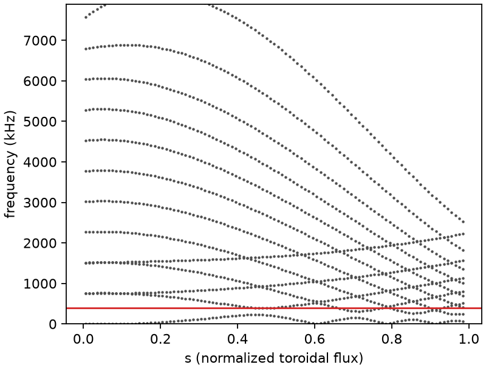
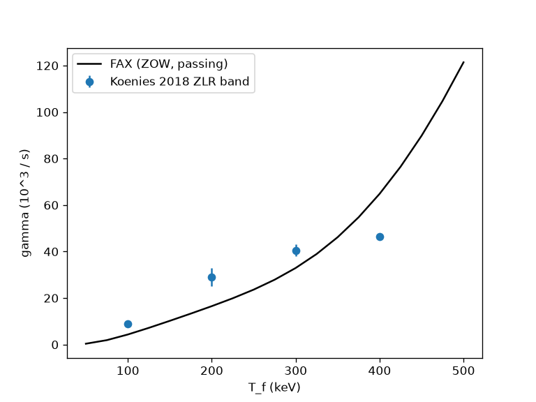

# FAX

[](https://github.com/uwplasma/fax/actions/workflows/tests.yml)
[](https://fax.readthedocs.io)
[](LICENSE)

FAX is a lean, differentiable JAX code for shear-Alfvén physics in
stellarators. It computes shear-Alfvén continua, AE3D-form global Alfvén
eigenmodes and a perturbative fast-ion drive, and differentiates all of them
with respect to profiles and, through [vmex](https://github.com/uwplasma/vmex)
and [booz_xform_jax](https://github.com/uwplasma/booz_xform_jax), the VMEC
plasma boundary.

<p align="center">
  
  
</p>

*Left: the n = 2 continuum of the CTOK tokamak with the six global modes
nearest 384 kHz (red). Right: fast-ion growth rate of the Könies et al. (2018)
ITPA TAE against the published zero-Larmor-radius band.*

## What it does

- **Continuum.** On each Boozer surface, the Galerkin form of the low-β
  continuum equation (Spong, Sanchez & Weller 2003), $K x = \omega^2 M x$, with
  FFT-exact angle averages and STELLGAP weighting. Gaps give the TAE, EAE, MAE
  and HAE windows.
- **Global modes.** The AE3D weak form (Spong, D'Azevedo & Todo 2010) with the
  full metric and the magnetic-shear term, linear radial finite elements and
  axis regularity, giving a block-tridiagonal $F y = \omega^2 G y$ solved near
  a target by shift-invert with a block Thomas factorization ($O(N H^3)$).
- **Gradients.** Hellmann–Feynman eigenvalue derivatives
  $\delta\lambda = y^\dagger(\delta F - \lambda\,\delta G)y$, cluster means
  that stay smooth through crossings, and vmex's implicit-function derivative
  of the converged equilibrium.
- **Drive.** The perturbative growth rate $\gamma_h = -P/2W$ for zero-orbit-width
  passing fast ions (Maxwellian or slowing-down) in Boozer geometry, with the
  drift from $\partial|B|$, $G$ and $I$, the toroidal and helical sideband
  resonances $\omega = |(m + \ell)\iota - (n + kN_{fp})|\,\omega_\zeta$, an exact
  resonance integral, plus bulk-ion Landau damping.

## Physical-potential vorticity

`fax.vorticity` assembles the global physical-potential model from the
[incompressible vorticity equation](https://arxiv.org/html/2603.03118v1#S2):

$$
K_{ij}=\int\nabla(Df_i)^*\cdot\nabla(Df_j)\,dV,\qquad
M_{ij}=\int\frac{\mu_0\rho}{B^2}\nabla f_i^*\cdot\nabla f_j\,dV,
\qquad D=\mathbf b\cdot\nabla.
$$

It retains shear and the full 3-D metric, supports complex/cosine harmonics and
regular axis/edge conditions, and differentiates assembly and isolated modes.
The solve wrapper reuses FAX's existing generalized eigensolver.

### Difference from the inspected AE3D source

For row/test harmonic $i$, let $q=B/(G+\iota I)$,
$\kappa_i=n_i-m_i\iota$, $\chi_i=m_i\theta-n_i\zeta$ and
$f_i=N_i(s)\cos\chi_i$. Direct differentiation gives

$$
\partial_s(Df_i)=
\left[q\kappa_iN_i'+(q_s\kappa_i-qm_i\iota')N_i\right]\sin\chi_i.
$$

Consequently, the shear coefficient of $N_iN_j'$ contains $-m_i\iota'\kappa_j$.
The inspected [public AE3D v31 source](https://github.com/ORNL-Fusion/AE3D/blob/master/ae_solve_version31.f#L912)
uses $-m_j\iota'\kappa_i$. Its mixed radial-poloidal shear term also interchanges
the pairings of $\kappa_i,\kappa_j$ with the sine/cosine products. FAX uses
$\kappa_j\sin\chi_i\cos\chi_j+\kappa_i\cos\chi_i\sin\chi_j$.
Changing between exponential and cosine bases does not change these pairings.

The derivation, exact manufactured solution and independent Cartesian finite
differences support the native indices **for this operator**. The published
QA run's modified AE3D revision is unavailable. Main's AE3D parity uses supplied
matrices and does not validate native construction. This model excludes acoustic
coupling, kinetic/resistive effects and equilibrium-current drive.

### Exact manufactured benchmark

On $0.1\le s\le0.9$, with $x=(s-0.1)/0.8$, prescribe

$$
\Phi_*=\sin(\pi x)\cos(2\theta-\zeta)
+[0.7\sin(2\pi x)+0.2\sin(3\pi x)]\cos(3\theta-3\zeta).
$$

The helical 3-D map has $\iota=0.3+0.8s$. Elementary Cartesian derivatives
provide the continuous forcing independently of FAX's coefficients, without AD.
Every case uses the same forcing, positive mass shift, boundaries and amplitude.
The synthetic directional field is not a unit-vector MHD equilibrium.

| Assembly, 129 radial nodes | Relative potential L2 error |
|---|---:|
| Native FAX | **0.01229%** |
| Radial shear index interchange | 3.0368% |
| Mixed-metric shear index interchange | 2.3335% |
| Both interchanges (AE3D-like control) | 4.6044% |

Native error converges quadratically; swapped-index errors plateau. Both
changes vanish at zero shear. This verifies the equation/assembly, without
running AE3D or reproducing a published eigenmode.


[Saved numerical comparison](examples/research/references/vorticity_benchmark.csv).
Reproduce on CPU (the example has a 50-second computation cap), or regenerate
only the figure from the saved CSV:

```bash
PYTHONPATH=src:. JAX_PLATFORMS=cpu python -m examples.research.vorticity_benchmark
PYTHONPATH=src:. python -m examples.research.vorticity_benchmark --plot-only
PYTHONPATH=src:. JAX_PLATFORMS=cpu python -m pytest -q tests/test_vorticity.py tests/test_vorticity_benchmark.py tests/test_vorticity_3d_cartesian.py
```

The 10 added tests cover dispersion, full derivatives/metric, boundaries,
interpolation, conventions, AD/JIT, exact forcing and Cartesian checks.
Existing main-branch tests are retained.

### QA AE3D–FAX comparison (unresolved)

The saved [QA profiles](examples/research/references/qa_ae3d_comparison.npz)
compare native construction with the [published archive](https://doi.org/10.5281/zenodo.21299908)
(Knyazev et al., CC BY 4.0). The calculations use 162 harmonics; errors compare
the 35 exported signed profiles after one global amplitude/sign alignment.

| Calculation | Frequency [kHz] | Aligned profile L2 error |
|---|---:|---:|
| Archived AE3D | 30.30861 | Reference |
| Native FAX, 51 nodes | 27.57218 | 62.53% |
| FAX with both shear index swaps | 30.10576 | 13.72% |
| Public AE3D formulas and endpoint convention | 30.29840 | 4.30% |

The last row reconstructs public-source coefficients; it does not import the
original QA matrices or execute AE3D. Native refinement to 101 nodes gives
27.52558 kHz and 58.92% profile error: physical-mode parity remains unestablished.
Matching the archive better does not establish the swapped operator's validity.
These are mode frequencies; the transport export's angular-frequency convention
is recorded separately in the data metadata. No particle-loss result is changed.


Regenerate from saved data, without downloads or a solve:

```bash
python -m examples.research.qa_ae3d_comparison
```

## Install

Python 3.10 or newer.

```bash
pip install uwplasma-fax              # core
pip install "uwplasma-fax[vmex]"      # VMEC solves and boundary gradients (Python >= 3.11)
```

## Run

From the command line, with a TOML case:

```bash
fax run examples/ctok_continuum.toml --plot     # results.npz, case.json, continuum.png
fax run examples/ctok_eigenmodes.toml --plot    # six global modes nearest 384 kHz
```

From Python:

```python
import jax, fax

geo = fax.read_boozmn("tests/data/boozmn_ctok.nc")
harmonics = fax.mode_family(2, 12)  # (m, n) for m = 0..12, n = 2
rho = fax.mass_density(1e19, ion_mass_amu=2.0)
f_hz = fax.continuum(geo, harmonics, rho)  # (surfaces, harmonics)
center_hz, width_hz = fax.gaps(f_hz)
modes = fax.eigenmodes(geo, harmonics, rho, target_hz=384e3, count=6)
dfdrho = jax.grad(lambda r: fax.frequency_hz(geo, harmonics, r, 2, 3, target_hz=384e3, count=6))(rho)
```

## Examples

| Example | What it shows |
|---|---|
| `examples/ctok_continuum.toml` | STELLGAP CTOK continuum from a `boozmn` file |
| `examples/ctok_eigenmodes.toml` | AE3D-form global modes by shift-invert |
| `examples/qa_continuum.toml` | precise QA: vmex solve → booz_xform_jax → continuum |
| `examples/boundary_gradient.py` | gradient of a frequency objective with respect to VMEC boundary coefficients |
| `examples/optimize_alfven.py` | QS + aspect + Paul's continuum-gap objective (QH) or a global-mode window (QA), `least_squares` with exact Jacobians |
| `examples/koenies_tae_drive.py` | fast-ion growth rate of the Könies ITPA TAE vs temperature |

## Validation

| Gate | Result |
|---|---|
| Uniform field, $\omega = \lvert n-m\iota\rvert v_A/R$ | exact to 1e-9 |
| STELLGAP CTOK continuum (97 surfaces, n = 2, m = 0–12) | mean 6.3e-3, p95 6.6e-3 relative |
| Uniform-field global spectrum fills $[\omega_A(0), \omega_A(1)]$ | edges within $0.5/N$, singular modes of width $\propto 1/N$ |
| AE3D CTOK global modes (n = 2, m = 0–12) | 6 modes within 1.4%; AE3D's TAE is off by its $\iota'$ sign error (checked by real-space quadrature to 0.3%) |
| Könies et al. 2018 ITPA TAE (n = 6) | $\omega$ = 4.061e5 rad/s (CAS3D 4.01e5, GYGLES 4.13e5), converged to 1e-4 |
| Könies ITPA with $p(s)$, vmex equilibrium, `finite_beta=True` | 3.947e5 rad/s (4.127e5 without the $J_\parallel$ and pressure terms) |
| Könies et al. 2018 drive, 100/200/300 keV | 4.37/16.6/33.2 vs 8–10/25–33/38–43 ×10³ s⁻¹ (ZOW, passing only; old circular model within 4%) |
| Eigenvalue and drive gradients vs finite differences | 1e-5 (drive: profiles, $\omega$, every geometry leaf, the mode) |
| LP-QA drive through vmex geometry and shift-invert eigenvectors | AD vs FD ≤ 1e-4; helical sidebands present (dominant in LP-QH) |

The compiled CTOK continuum takes 0.04 s on one CPU core (STELLGAP 0.8 s); the
six-mode CTOK shift-invert takes 0.07 s. Not yet included: sound and
fast-wave coupling, trapped particles and finite orbit width in the drive. Details are on the
[validation page](https://fax.readthedocs.io/en/latest/validation.html).

## Documentation

[fax.readthedocs.io](https://fax.readthedocs.io): getting started and the TOML
reference, tutorials, full derivations, validation and the API.

## Testing

```bash
pip install -e ".[dev,vmex]"
python -m pytest -q          # fast suite; add -m '' for the slow vmex end-to-end tests
ruff check . && ruff format --check .
sphinx-build -W -b html docs docs/_build/html
```

## Contributing and citing

Issues and pull requests are welcome; every physics change needs a test against
an analytic result or a published number. If you use FAX, please cite this
repository and Spong, Sanchez & Weller (2003), Spong, D'Azevedo & Todo (2010)
and Könies et al. (2018); see the
[references](https://fax.readthedocs.io/en/latest/references.html).

## License

MIT.
