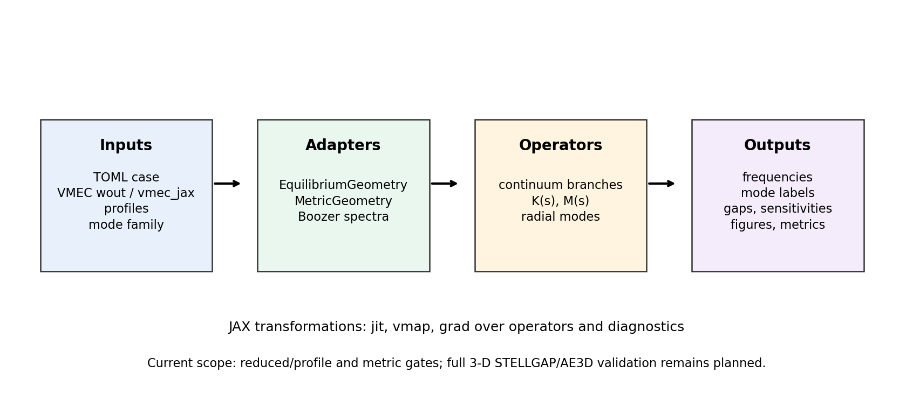
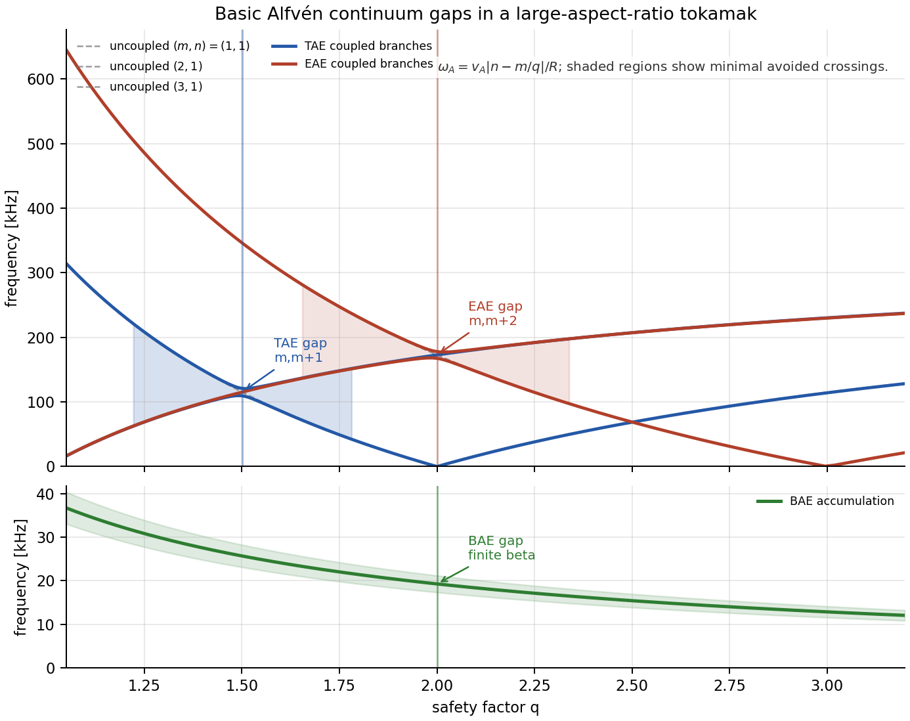
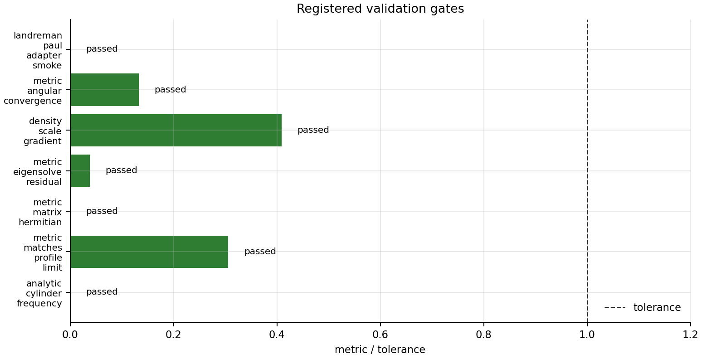

# FAX

[](https://github.com/uwplasma/fax/actions/workflows/tests.yml)
[](https://github.com/uwplasma/fax/actions/workflows/docs.yml)
[](https://github.com/uwplasma/fax/actions/workflows/publish.yml)
[](https://fax.readthedocs.io/en/latest/?badge=latest)
[](docs/_static/coverage.svg)
[](https://pypi.org/project/uwplasma-fax/)
[](https://pypi.org/project/uwplasma-fax/)
[](LICENSE)
[](https://docs.astral.sh/ruff/)
[](https://github.com/jax-ml/jax)

FAX is a differentiable JAX research code for Alfvén continua, Alfvén
eigenmode screening, gap physics, Boozer-coordinate stellarator operators,
fast-ion drive/damping diagnostics, and design sensitivities. It is built to
sit downstream of `vmec_jax` and `booz_xform_jax`, with TOML-driven workflows,
publication-style figures, and validation artifacts that are easy to regenerate.

FAX v0.0.1 is not yet a full ideal-MHD/kinetic replacement for AE3D, CAS3D,
FAR3D, or STELLGAP. It does provide a tested JAX foundation for research:
profile and metric continuum operators, real `boozmn` local 3-D Boozer
operators, reduced global radial eigenmodes, differentiable eigenvalue and
cluster objectives, reduced gyro-Landau fast-ion closures, STELLGAP CTOK local
continuum/gap parity, and AE3D public matrix/eigenmode parity.



## What It Solves

FAX uses profile, metric, Boozer, and radial-block models that share the same
validation registry. The profile-limit continuum is

$$
v_A(s)=\frac{B(s)}{\sqrt{\mu_0\rho(s)}},\qquad
k_{\parallel,mn}(s)=\frac{n-m\iota(s)}{R},\qquad
\omega_{A,mn}(s)=v_A(s)|k_{\parallel,mn}(s)|.
$$

The metric and Boozer local operators solve generalized Hermitian problems,

$$
K_{ij}(s)=\left\langle J\,\frac{|B|^2}{\mu_0}
k_{\parallel i}k_{\parallel j}\phi_i^*\phi_j\right\rangle,\qquad
M_{ij}(s)=\left\langle J\,\rho\,\phi_i^*\phi_j\right\rangle,
\qquad
Kx=\omega^2Mx.
$$

For real Boozer geometry, FAX uses straight-field-line coordinates and the
Boozer Jacobian,

$$
k_{\parallel,mn}=
\frac{(n-m\iota)|B|}{G+\iota I},\qquad
\sqrt{g}_B|B|^2=G+\iota I,
$$

then promotes local surface matrices to a reduced global radial block problem,

$$
K_r\xi=\omega^2M_r\xi.
$$

Gap and fast-ion screens use analytic crossing and resonance diagnostics,

$$
\iota_{\mathrm{gap}}=\frac{2n}{2m+\Delta m},\qquad
f_{\mathrm{mode}}-n f_\phi-\ell f_\theta=0,
$$

with a reduced gyro-Landau closure for calibrated drive/damping studies,

$$
\Gamma_k=S_f\langle D_{\mathrm{GL}}\rangle_{|\xi_k|^2}
-\gamma_{\mathrm{damp}}-\gamma_L.
$$

The detailed derivations, assumptions, and claim levels are in
[the equations documentation](docs/equations.rst) and
[the model inventory](docs/model_inventory.rst).

## Install

From this repository:

```bash
python -m pip install -e ".[dev]"
fax --help
```

After PyPI publishing is available, the package name is:

```bash
python -m pip install uwplasma-fax
```

The import package and CLI are both `fax`. Python 3.10 and newer are supported;
Python 3.10 uses the `tomli` fallback, while Python 3.11+ uses `tomllib`.

For local VMEC/Boozer coupling tests:

```bash
python -m pip install -e /Users/rogerio/local/vmec_jax
python -m pip install -e /Users/rogerio/local/booz_xform_jax
```

## Quick Use

Run validation and continuum workflows from TOML:

```bash
fax examples/minimal.toml --dry-run
fax validate examples/minimal.toml
fax continuum examples/landreman_paul_qa_lowres.toml
fax plot-continuum outputs/landreman_paul_qa_lowres \
  --output-dir outputs/landreman_paul_qa_lowres/figures
```

Run global eigenmodes and plot radial/harmonic mode structures:

```bash
fax eigenmodes examples/global_eigenmodes.toml --max-modes 6
fax plot-global outputs/global_eigenmodes/eigenmodes \
  --output-dir outputs/global_eigenmodes/figures
```

Generate a fast literature-style gap map:

```bash
python examples/research/basic_alfven_gap_map.py
```



Run the ten-figure publication packet:

```bash
python examples/research/publication_figure_suite.py \
  --output-dir outputs/publication_figure_suite
python tools/qa_figures.py --figure-dir outputs/publication_figure_suite
```

Python workflows are progress-aware and return structured summaries:

```python
import jax
import jax.numpy as jnp
from fax import analytic_circular_tokamak, load_config, run_continuum, run_global_eigenmodes
from fax.optimization import radial_mode_frequency_vector

continuum = run_continuum(load_config("examples/minimal.toml"), progress=True)
global_modes = run_global_eigenmodes(load_config("examples/global_eigenmodes.toml"))
geometry = analytic_circular_tokamak(radial_points=32)

def first_mode(log_density_scale):
    params = jnp.array([log_density_scale, 0.0, 0.0])
    return radial_mode_frequency_vector(
        params, geometry=geometry, harmonic=(2, 1), mode_count=1
    )[0]

sensitivity = jax.grad(first_mode)(0.0)
```

More examples are in [examples/research](examples/research/README.md) and
[the research examples documentation](docs/research_examples.rst).

## Validation And Cross-Code Status

The v0.0.1 gate currently covers:

- analytic continuum limits, density scaling, gap ordering, and residual checks,
- metric/Boozer Hermiticity, generalized-eigen residuals, Jacobian identities,
  angular/radial convergence, and Dirichlet/Neumann radial boundary variants,
- isolated-eigenvalue custom-JVP gradients, cluster-mean gradients for mode
  crossings, finite-difference sensitivity checks, and linearized UQ examples,
- reduced fast-ion resonance signs, eigenfunction weighting, and calibrated
  gyro-Landau closure coefficient recovery,
- STELLGAP CTOK local-continuum and largest-local-gap parity,
- AE3D public `A x = lambda B x` matrix, spectrum, and B-weighted mode-shape
  parity.

Current headline local metrics are 206 passing tests, 95.1% coverage,
STELLGAP CTOK p95 sorted-spectrum relative error about 2.55%, AE3D dense
spectrum max relative error about 1.6e-6, and AE3D B-weighted mode-shape error
about 5.2e-8 for the checked public modes.



Full traceability is in [validation](docs/validation.rst),
[validation traceability](docs/validation_traceability.rst), and
[publication results](docs/publication_results.rst).

## What Is New Relative To Legacy AE Codes

FAX is designed around differentiability and reproducibility rather than
only batch eigenvalue production:

- JAX-native profile, matrix, radial-block, and objective kernels.
- Custom derivatives for isolated generalized eigenvalues and cluster-mean
  objectives near crossings.
- Machine-readable TOML, JSON, CSV, Markdown, and figure artifacts from the CLI.
- Cross-code artifact gates that are part of the test suite, not just notebooks.
- Publication figure generation and QA as first-class workflows.
- Builder APIs intended for `vmec_jax -> booz_xform_jax -> FAX` optimization.

The remaining paper-grade lanes are native global FAX-vs-AE3D/STELLGAP
operator parity, CAS3D/CAS3D-K and FAR3D growth-rate comparisons, calibrated
kinetic closures, and converged VMEC boundary/design-variable gradients.

## Development

Run the local release gate:

```bash
python -m ruff check .
python -m mypy src/fax
python -m coverage run --source=src/fax -m pytest
python -m coverage report --fail-under=95
python tools/generate_validation_figures.py
python tools/qa_figures.py --figure-dir docs/_static
python tools/qa_figures.py --figure-dir docs/_static/publication_suite
python -m sphinx -W -b html docs docs/_build/html
python -m build
python -m twine check dist/*
```

The code is MIT licensed. The detailed handoff and milestone log is in
[plan.md](plan.md).
