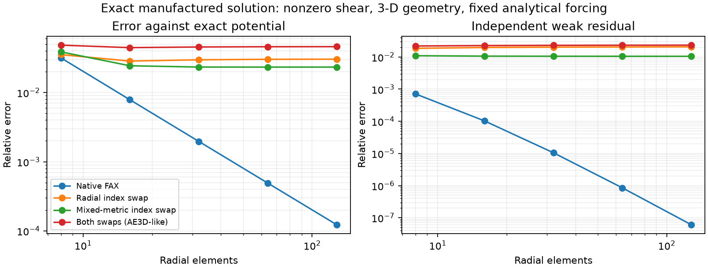
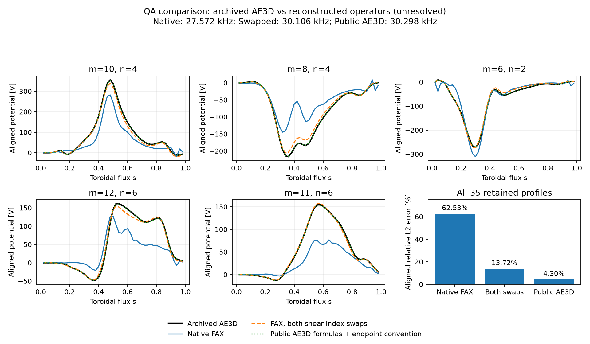
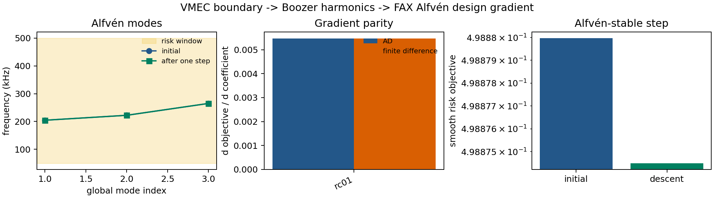
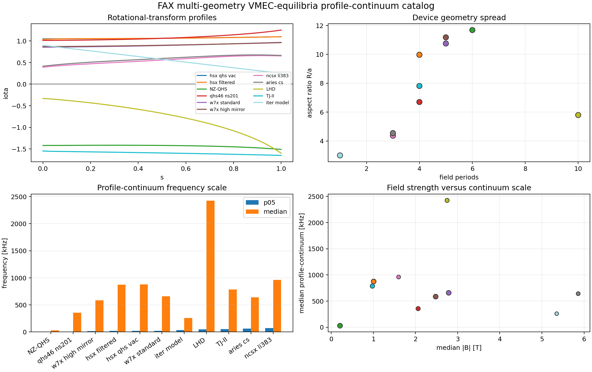
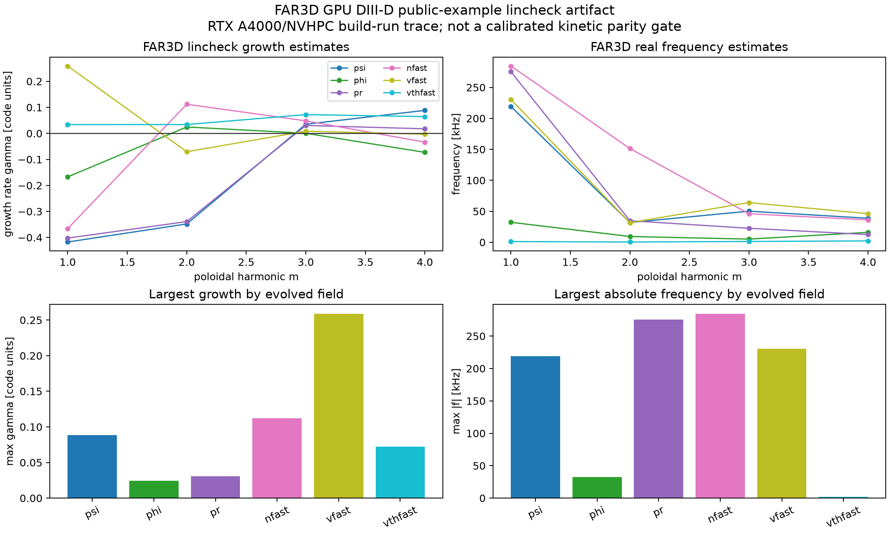
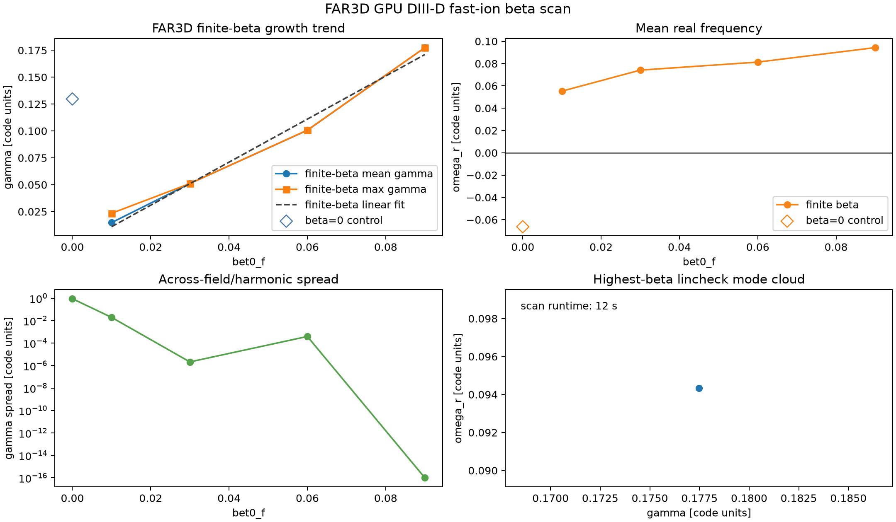

# FAX

[](https://github.com/uwplasma/fax/actions/workflows/tests.yml)
[](https://github.com/uwplasma/fax/actions/workflows/docs.yml)
[](https://github.com/uwplasma/fax/actions/workflows/publish.yml)
[](https://fax.readthedocs.io/en/latest/?badge=latest)
[](docs/_static/coverage.svg)
[](https://pypi.org/project/uwplasma-fax/)
[](https://pypi.org/project/uwplasma-fax/)
[](LICENSE)
[](https://docs.astral.sh/ruff/)
[](https://github.com/jax-ml/jax)

FAX is a differentiable JAX research code for Alfvén continua, Alfvén
eigenmode screening, gap physics, Boozer-coordinate stellarator operators,
fast-ion drive/damping diagnostics, and design sensitivities. It is built to
sit downstream of `vmex` and `booz_xform_jax`, with TOML-driven workflows,
publication-style figures, and validation artifacts that are easy to regenerate.

FAX v0.0.2 is not yet a full ideal-MHD/kinetic replacement for AE3D, CAS3D,
FAR3D, or STELLGAP. It does provide a tested JAX foundation for research:
profile and metric continuum operators, real `boozmn` local 3-D Boozer
operators, reduced global radial eigenmodes, differentiable eigenvalue and
cluster objectives, reduced gyro-Landau fast-ion closures, STELLGAP CTOK local
continuum/gap parity, AE3D public matrix/eigenmode parity, and an archived
FAR3D GPU build/run `lincheck` ingestion artifact. It also has a maintained
in-memory VMEC boundary-coefficient gradient path through `vmex`,
`booz_xform_jax`, and a FAX global Alfvén risk objective.


## What It Solves

FAX uses profile, metric, Boozer, and radial-block models that share the same
validation registry. The profile-limit continuum is

$$
v_A(s)=\frac{B(s)}{\sqrt{\mu_0\rho(s)}},\qquad
k_{\parallel,mn}(s)=\frac{n-m\iota(s)}{R},\qquad
\omega_{A,mn}(s)=v_A(s)|k_{\parallel,mn}(s)|.
$$

The metric and Boozer local operators solve generalized Hermitian problems,

$$
K_{ij}(s)=\left\langle J\,\frac{|B|^2}{\mu_0}
k_{\parallel i}k_{\parallel j}\phi_i^*\phi_j\right\rangle,\qquad
M_{ij}(s)=\left\langle J\,\rho\,\phi_i^*\phi_j\right\rangle,
\qquad
Kx=\omega^2Mx.
$$

For real Boozer geometry, FAX uses straight-field-line coordinates and the
Boozer Jacobian,

$$
k_{\parallel,mn}=
\frac{(n-m\iota)|B|}{G+\iota I},\qquad
\sqrt{g}_B|B|^2=G+\iota I,
$$

then promotes local surface matrices to a reduced global radial block problem,

$$
K_r\xi=\omega^2M_r\xi.
$$

Gap and fast-ion screens use analytic crossing and resonance diagnostics,

$$
\iota_{\mathrm{gap}}=\frac{2n}{2m+\Delta m},\qquad
f_{\mathrm{mode}}-n f_\phi-\ell f_\theta=0,
$$

with a reduced gyro-Landau closure for calibrated drive/damping studies,

$$
\Gamma_k=S_f\langle D_{\mathrm{GL}}\rangle_{|\xi_k|^2}
-\gamma_{\mathrm{damp}}-\gamma_L.
$$

The detailed derivations, assumptions, and claim levels are in
[the equations documentation](docs/equations.rst) and
[the model inventory](docs/model_inventory.rst).

## Physical-potential vorticity

`fax.vorticity` assembles the global physical-potential model from the
[incompressible vorticity equation](https://arxiv.org/html/2603.03118v1#S2):

$$
K_{ij}=\int\nabla(Df_i)^*\cdot\nabla(Df_j)\,dV,\qquad
M_{ij}=\int\frac{\mu_0\rho}{B^2}\nabla f_i^*\cdot\nabla f_j\,dV,
\qquad D=\mathbf b\cdot\nabla.
$$

It retains shear and the full 3-D metric, supports complex/cosine harmonics and
regular axis/edge conditions, and differentiates assembly and isolated modes.
The solve wrapper reuses FAX's existing generalized eigensolver.

### Difference from the inspected AE3D source

For row/test harmonic $i$, let $q=B/(G+\iota I)$,
$\kappa_i=n_i-m_i\iota$, $\chi_i=m_i\theta-n_i\zeta$ and
$f_i=N_i(s)\cos\chi_i$. Direct differentiation gives

$$
\partial_s(Df_i)=
\left[q\kappa_iN_i'+(q_s\kappa_i-qm_i\iota')N_i\right]\sin\chi_i.
$$

Consequently, the shear coefficient of $N_iN_j'$ contains $-m_i\iota'\kappa_j$.
The inspected [public AE3D v31 source](https://github.com/ORNL-Fusion/AE3D/blob/master/ae_solve_version31.f#L912)
uses $-m_j\iota'\kappa_i$. Its mixed radial-poloidal shear term also interchanges
the pairings of $\kappa_i,\kappa_j$ with the sine/cosine products. FAX uses
$\kappa_j\sin\chi_i\cos\chi_j+\kappa_i\cos\chi_i\sin\chi_j$.
Changing between exponential and cosine bases does not change these pairings.

The derivation, exact manufactured solution and independent Cartesian finite
differences support the native indices **for this operator**. The published
QA run's modified AE3D revision is unavailable. Main's AE3D parity uses supplied
matrices and does not validate native construction. This model excludes acoustic
coupling, kinetic/resistive effects and equilibrium-current drive.

### Exact manufactured benchmark

On $0.1\le s\le0.9$, with $x=(s-0.1)/0.8$, prescribe

$$
\Phi_*=\sin(\pi x)\cos(2\theta-\zeta)
+[0.7\sin(2\pi x)+0.2\sin(3\pi x)]\cos(3\theta-3\zeta).
$$

The helical 3-D map has $\iota=0.3+0.8s$. Elementary Cartesian derivatives
provide the continuous forcing independently of FAX's coefficients, without AD.
Every case uses the same forcing, positive mass shift, boundaries and amplitude.
The synthetic directional field is not a unit-vector MHD equilibrium.

| Assembly, 129 radial nodes | Relative potential L2 error |
|---|---:|
| Native FAX | **0.01229%** |
| Radial shear index interchange | 3.0368% |
| Mixed-metric shear index interchange | 2.3335% |
| Both interchanges (AE3D-like control) | 4.6044% |

Native error converges quadratically; swapped-index errors plateau. Both
changes vanish at zero shear. This verifies the equation/assembly, without
running AE3D or reproducing a published eigenmode.



[Saved numerical comparison](examples/research/references/vorticity_benchmark.csv).
Reproduce on CPU (the example has a 50-second computation cap), or regenerate
only the figure from the saved CSV:

```bash
PYTHONPATH=src:. JAX_PLATFORMS=cpu python -m examples.research.vorticity_benchmark
PYTHONPATH=src:. python -m examples.research.vorticity_benchmark --plot-only
PYTHONPATH=src:. JAX_PLATFORMS=cpu python -m pytest -q tests/test_vorticity.py tests/test_vorticity_benchmark.py tests/test_vorticity_3d_cartesian.py
```

The 10 added tests cover dispersion, full derivatives/metric, boundaries,
interpolation, conventions, AD/JIT, exact forcing and Cartesian checks.
Existing main-branch tests are retained.

### QA AE3D–FAX comparison (unresolved)

The saved [QA profiles](examples/research/references/qa_ae3d_comparison.npz)
compare native construction with the [published archive](https://doi.org/10.5281/zenodo.21299908)
(Knyazev et al., CC BY 4.0). The calculations use 162 harmonics; errors compare
the 35 exported signed profiles after one global amplitude/sign alignment.

| Calculation | Frequency [kHz] | Aligned profile L2 error |
|---|---:|---:|
| Archived AE3D | 30.30861 | Reference |
| Native FAX, 51 nodes | 27.57218 | 62.53% |
| FAX with both shear index swaps | 30.10576 | 13.72% |
| Public AE3D formulas and endpoint convention | 30.29840 | 4.30% |

The last row reconstructs public-source coefficients; it does not import the
original QA matrices or execute AE3D. Native refinement to 101 nodes gives
27.52558 kHz and 58.92% profile error: physical-mode parity remains unestablished.
Matching the archive better does not establish the swapped operator's validity.
These are mode frequencies; the transport export's angular-frequency convention
is recorded separately in the data metadata. No particle-loss result is changed.



Regenerate from saved data, without downloads or a solve:

```bash
python -m examples.research.qa_ae3d_comparison
```

## Install

From this repository:

```bash
python -m pip install -e ".[dev]"
fax --help
```

After PyPI trusted publishing is configured, the package name is:

```bash
python -m pip install uwplasma-fax
```

The import package and CLI are both `fax`. Python 3.10 and newer are supported;
Python 3.10 uses the `tomli` fallback, while Python 3.11+ uses `tomllib`.

External checkouts (`booz_xform_jax`, `vmec_equilibria`, STELLGAP/AE3D test
packets) are read from `$FAX_EXTERNAL_ROOT`, default `~/local`.

For local VMEC/Boozer coupling tests:

```bash
python -m pip install -e ".[vmex]"  # Python 3.11+
python -m pip install -e ~/local/booz_xform_jax
```

## Quick Use

Run validation and continuum workflows from TOML:

```bash
fax examples/minimal.toml --dry-run
fax validate examples/minimal.toml
fax continuum examples/landreman_paul_qa_lowres.toml
fax plot-continuum outputs/landreman_paul_qa_lowres \
  --output-dir outputs/landreman_paul_qa_lowres/figures
```

Run global eigenmodes and plot radial/harmonic mode structures:

```bash
fax eigenmodes examples/global_eigenmodes.toml --max-modes 6
fax plot-global outputs/global_eigenmodes/eigenmodes \
  --output-dir outputs/global_eigenmodes/figures
```

Generate a fast literature-style gap map:

```bash
python examples/research/basic_alfven_gap_map.py
```


Check an end-to-end VMEC-boundary design gradient:

```bash
python examples/research/vmec_boozer_alfven_design_gradient.py \
  --output-dir outputs/vmec_boozer_alfven_design_gradient
python examples/research/vmec_boozer_gradient_convergence.py \
  --output-dir outputs/vmec_boozer_gradient_convergence
```



Run the ten-figure publication packet:

```bash
python examples/research/publication_figure_suite.py \
  --output-dir outputs/publication_figure_suite
python tools/qa_figures.py --figure-dir outputs/publication_figure_suite
```

Python workflows are progress-aware and return structured summaries:

```python
import jax
import jax.numpy as jnp
from fax import analytic_circular_tokamak, load_config, run_continuum, run_global_eigenmodes
from fax.optimization import radial_mode_frequency_vector

continuum = run_continuum(load_config("examples/minimal.toml"), progress=True)
global_modes = run_global_eigenmodes(load_config("examples/global_eigenmodes.toml"))
geometry = analytic_circular_tokamak(radial_points=32)

def first_mode(log_density_scale):
    params = jnp.array([log_density_scale, 0.0, 0.0])
    return radial_mode_frequency_vector(
        params, geometry=geometry, harmonic=(2, 1), mode_count=1
    )[0]

sensitivity = jax.grad(first_mode)(0.0)
```

More examples are in [examples/research](examples/research/README.md) and
[the research examples documentation](docs/research_examples.rst).

FAX can also read the public
[`landreman/vmec_equilibria`](https://github.com/landreman/vmec_equilibria)
checkout as an external geometry matrix:

```bash
git clone https://github.com/landreman/vmec_equilibria ~/local/vmec_equilibria
python examples/research/vmec_equilibria_catalog.py --root ~/local/vmec_equilibria
python examples/research/vmec_equilibria_boozer_global.py --root ~/local/vmec_equilibria
python examples/research/vmec_equilibria_live_boozer.py --root ~/local/vmec_equilibria --jit
```



## Validation And Cross-Code Status

The v0.0.2 gate currently covers:

- analytic continuum limits, density scaling, gap ordering, and residual checks,
- metric/Boozer Hermiticity, generalized-eigen residuals, Jacobian identities,
  angular/radial convergence, and Dirichlet/Neumann radial boundary variants,
- isolated-eigenvalue custom-JVP gradients, cluster-mean gradients for mode
  crossings, finite-difference sensitivity checks, and linearized UQ examples,
- Landreman-Paul QA VMEC boundary-coefficient gradients through
  `vmex -> booz_xform_jax -> FAX`, checked against centered finite
  differences, a one-step Alfvén-risk descent, and a VMEC/Boozer refinement
  ladder,
- reduced fast-ion resonance signs, eigenfunction weighting, and calibrated
  gyro-Landau closure coefficient recovery,
- STELLGAP CTOK local-continuum and largest-local-gap parity,
- AE3D public `A x = lambda B x` matrix, spectrum, and B-weighted mode-shape
  parity, plus AE3D global-mode peak placement against the FAX CTOK local
  Boozer continuum,
- FAR3D GPU executable-run traceability for the public DIII-D example, with
  parsed `lincheck` growth/frequency rows and a run-reported code-frequency
  normalization, a 50/100/200/400-step convergence ladder, and a finite-beta
  parameter scan.
- public VMEC-equilibria Boozer artifacts for HSX and Ku-Boozer QHS cases,
  propagated through FAX's global radial 3-D Boozer operator with
  boundary-condition and radial-stiffness variants.
- live `booz_xform_jax` generation from public W7-X/NCSX VMEC-equilibria
  `wout` files into FAX global radial 3-D Boozer diagnostics.

Current headline metrics are 246 passing tests, a 95% local optional-artifact
release gate, and a 91.1% public CI coverage badge. Physics parity metrics
include STELLGAP CTOK p95 sorted-spectrum relative error about 2.55%, AE3D dense
spectrum max relative error about 1.6e-6, and AE3D B-weighted mode-shape error
about 5.2e-8 for the checked public modes; AE3D mode-peak closest-continuum
placement p95 error is below 3%.


Full traceability is in [validation](docs/validation.rst),
[validation traceability](docs/validation_traceability.rst), and
[publication results](docs/publication_results.rst).
The remaining full-physics milestones are tracked by `fax maturity` and
[the full research-grade roadmap](docs/research_grade_roadmap.rst).
Current external-code artifacts are tracked by `fax benchmark-manifest` and
[the benchmark manifest](docs/benchmark_manifest.rst).
FAR3D/CAS3D-K growth-rate packets are checked with `fax kinetic-parity`; this
is a held-out validation contract, not yet a completed kinetic-code replacement.
FAR3D `lincheck` logs can be converted into that schema with explicit unit
normalization. The repository includes one real FAR3D/NVHPC GPU run artifact
for parser and runtime traceability; it is not yet a converged kinetic parity
benchmark. A follow-on `maxstp = 50, 100, 200, 400` ladder on the same case
shows the 200-step `lincheck` output within `3e-5` maximum relative
growth-rate difference of the 400-step reference. A first `bet0_f` scan on the
same executable/input shows a monotonic finite-beta growth branch and keeps the
beta-zero output as a flagged control, still not as calibrated FAR3D/FAX
kinetic parity.

```bash
fax far3d-ingest far3d.out --dataset-id far3d_ctok_linear_v1 \
  --geometry-id ctok --frequency-scale-hz 2.0e6 \
  --growth-rate-scale-hz 2.0e6 --output kinetic_dataset.json
```





## What Is New Relative To Legacy AE Codes

FAX is designed around differentiability and reproducibility rather than
only batch eigenvalue production:

- JAX-native profile, matrix, radial-block, and objective kernels.
- Custom derivatives for isolated generalized eigenvalues and cluster-mean
  objectives near crossings.
- Machine-readable TOML, JSON, CSV, Markdown, and figure artifacts from the CLI.
- Cross-code artifact gates that are part of the test suite, not just notebooks.
- Publication figure generation and QA as first-class workflows.
- Direct builder and VMEC-boundary APIs for `vmex -> booz_xform_jax -> FAX`
  optimization studies.

The remaining paper-grade lanes are native global FAX-vs-AE3D/STELLGAP
operator parity, CAS3D/CAS3D-K and FAR3D growth-rate comparisons, calibrated
kinetic closures, and high-iteration converged VMEC boundary/design-variable
gradient campaigns across multiple geometries.

## Development

Run the local release gate:

```bash
python -m ruff check .
python -m mypy src/fax
python -m coverage run --source=src/fax -m pytest
python -m coverage report --fail-under=95
python tools/generate_validation_figures.py
python tools/qa_figures.py --figure-dir docs/_static
python tools/qa_figures.py --figure-dir docs/_static/publication_suite
python -m sphinx -W -b html docs docs/_build/html
python -m build
python -m twine check dist/*
```

The code is MIT licensed. The detailed handoff and milestone log is in
[plan.md](plan.md).
