# fax

[](https://github.com/uwplasma/fax/actions/workflows/tests.yml)
[](https://github.com/uwplasma/fax/actions/workflows/docs.yml)
[](https://github.com/uwplasma/fax/actions/workflows/publish.yml)
[](https://fax.readthedocs.io/en/latest/?badge=latest)
[](docs/_static/coverage.svg)
[](https://pypi.org/project/uwplasma-fax/)
[](https://pypi.org/project/uwplasma-fax/)
[](LICENSE)
[](https://docs.astral.sh/ruff/)
[](https://github.com/jax-ml/jax)

The GitHub, ReadTheDocs, PyPI, and coverage badges update from the repository
workflows. The coverage badge is regenerated on `main` pushes by the test
workflow and committed back to `docs/_static/coverage.svg`.

`fax` is a planned end-to-end differentiable JAX code for Alfvén eigenmodes,
fast-ion drive, continuum gaps, and toroidal/helical coupling in stellarators.

The project is intentionally coupled to the UWPlasma JAX ecosystem:

- `vmec_jax` supplies differentiable MHD equilibria and VMEC-compatible output.
- `booz_xform_jax` supplies Boozer-coordinate transforms when the selected
  model needs straight-field-line Boozer geometry.
- `fax` supplies Alfvén-continuum, global-eigenmode, and fast-ion stability
  models with validation artifacts suitable for design studies.

The current repository state has the first executable physics foundation:
packaging, CLI, docs, local tests, analytic equilibrium fixtures, a minimal VMEC
`wout` profile adapter, local Alfvén-continuum smoke-test formulas, mode-family
helpers, gap/sensitivity diagnostics, a first metric-matrix continuum scaffold,
a reduced radial global-eigenmode operator, reduced fast-ion resonance screens,
an optional Boozer adapter, real `boozmn` geometry/Jacobian readers, a local
3-D Boozer continuum operator, a registered validation-gate inventory, and
generated documentation figures. It also has differentiable sensitivity,
linearized uncertainty, inverse-design, and reduced fast-ion risk screens for
the current radial model. The first public STELLGAP CTOK local-continuum parity
gate and AE3D public sparse-matrix/eigenmode parity gate are implemented.
Broader FAX reduced-operator parity against AE3D/CAS3D/FAR3D and perturbative
kinetic fast-ion growth-rate models are still planned work.


The workflow figure is generated by `tools/generate_validation_figures.py`.
Generated README figures use PNG for reliable GitHub rendering; matching SVG
files are tracked beside them for Sphinx/docs use.

## What FAX Solves Today

The implemented continuum scaffold has two levels.

The profile-limit local shear-Alfvén continuum is

```math
v_A(s)=\frac{B(s)}{\sqrt{\mu_0\rho(s)}}, \qquad
k_{\parallel,mn}(s)=\frac{n-m\iota(s)}{R},
```

```math
\omega_{A,mn}(s)=v_A(s)\left|k_{\parallel,mn}(s)\right|.
```

The first metric-matrix scaffold uses angular harmonics
`phi_j = exp(i (m_j theta - n_j zeta))` and solves, on each flux surface,

```math
K_{ij} =
\left\langle J \frac{B^2}{\mu_0}
k_{\parallel i} k_{\parallel j}
\phi_i^* \phi_j \right\rangle_{\theta,\zeta},
\qquad
M_{ij} =
\left\langle J \rho
\phi_i^* \phi_j \right\rangle_{\theta,\zeta},
```

```math
K(s)x = \omega^2(s) M(s)x.
```

The newest Boozer path reads real `boozmn` geometry harmonics, builds the same
`BoozerGeometry` object directly from a VMEC `wout` through `booz_xform_jax`,
or accepts an in-memory VMEC `wout`-like object for the no-intermediate-file
`vmec_jax -> booz_xform_jax -> FAX` route. The
`run_vmec_jax_fixed_boundary_boozer_geometry` helper now runs a short
`vmec_jax` fixed-boundary solve and hands the live `wout` object to the same
adapter. That path is currently a Landreman-Paul QA integration smoke gate, not
a converged equilibrium validation. It uses the straight-field-line derivative

```math
k_{\parallel,mn}(s,\theta_B,\zeta_B)=
\frac{[n-m\iota(s)]\,|B|(s,\theta_B,\zeta_B)}{G(s)+\iota(s)I(s)}.
```

It forms a local 3-D surface matrix with the Boozer Jacobian and
embedding-derived radial metric,

```math
K_{ij}^{3D} =
\left\langle |\sqrt{g}_B|\,|\nabla s|^2
\frac{|B|^2}{\mu_0} k_{\parallel i} k_{\parallel j}
\phi_i^*\phi_j\right\rangle,
\qquad
M_{ij}^{3D} =
\left\langle |\sqrt{g}_B|\,|\nabla s|^2\rho
\phi_i^*\phi_j\right\rangle.
```

The first reduced global layer solves a radial generalized eigenproblem with
Dirichlet radial boundaries,

```math
K_r \xi = \omega^2 M_r \xi,
```

validated against the exact constant-coefficient finite-difference spectrum.
Analytic gap screens use

```math
\iota_{\rm gap} = \frac{2n}{2m+\Delta m}
```

for coupled `m` and `m + Delta m` sidebands. The reduced fast-ion screen ranks
resonance windows using

```math
f_{\rm mode} - n f_\phi - \ell f_\theta = 0.
```

These equations are the current tested scaffold. They are anchored in the
standard shear-Alfvén continuum and energetic-particle literature, including
Chen & Zonca's review of Alfvén waves and energetic particles, the STELLGAP
stellarator continuum/gap code record, the Landreman-Paul precise
quasisymmetry configuration used as the first local VMEC target, and recent
quasisymmetric-stellarator continuum work:

- Chen & Zonca, Rev. Mod. Phys. 88, 015008 (2016): <https://doi.org/10.1103/RevModPhys.88.015008>
- STELLGAP software record: <https://www.osti.gov/biblio/code-4633>
- Landreman & Paul, Phys. Rev. Lett. 128, 035001 (2022): <https://doi.org/10.1103/PhysRevLett.128.035001>
- Paul et al., "The shear Alfvén continuum of quasisymmetric stellarators", JPP 91, E101 (2025): <https://doi.org/10.1017/S0022377825100524>

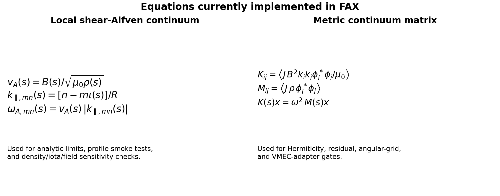

## Figures And Current Outputs

All figures below are generated from local code and checked for nonblank
rendering by `python tools/qa_figures.py`.

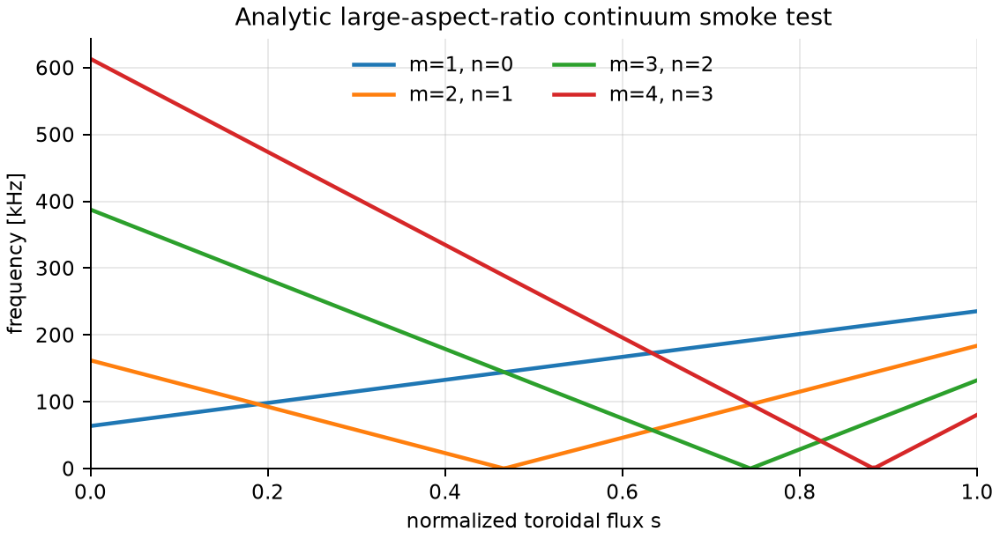

This is the analytic large-aspect-ratio profile limit. It is used to check
branch labeling, signs, density scaling, and differentiability of the simplest
continuum formulas.

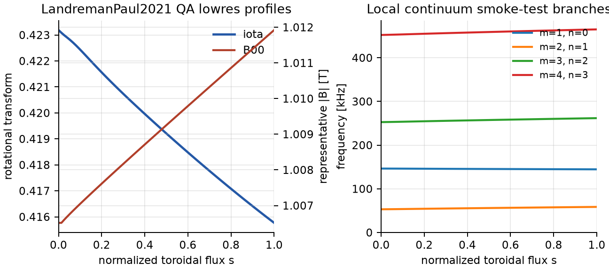

This is the first local VMEC-backed stellarator reference target. It reads the
LandremanPaul2021 QA lowres `wout` from the neighboring `vmec_jax` checkout,
extracts profile-level geometry, and computes local continuum smoke-test
branches. It is not yet a full 3-D stellarator continuum validation.


This fast example reproduces the textbook large-aspect-ratio continuum picture:
cylindrical branches `omega_A=v_A |n-m/q|/R`, toroidicity opening the TAE gap
near `q=(2m+1)/(2n)`, ellipticity opening the EAE gap near `q=(m+1)/n`, and a
finite-beta/acoustic BAE accumulation-frequency marker. Generate it with
`python examples/research/basic_alfven_gap_map.py`.

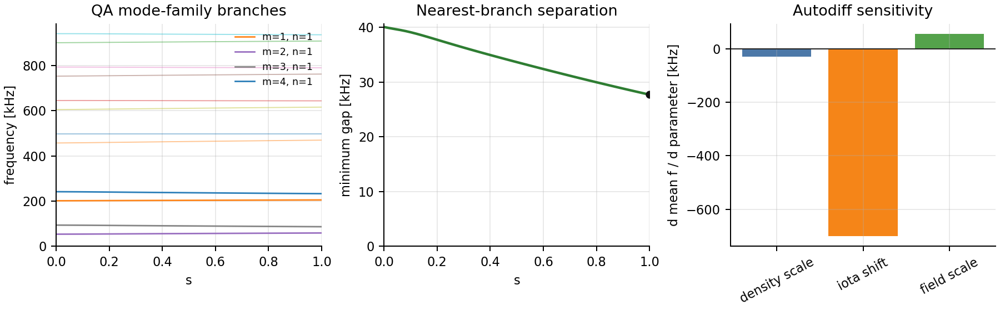

This dashboard shows a stellarator sideband family, nearest-branch separation,
and autodiff sensitivities to density, rotational-transform shift, and magnetic
field scale. It is a design-facing diagnostic prototype.

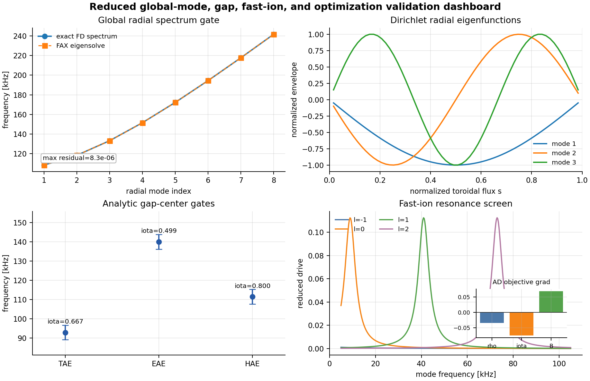

This dashboard checks the reduced radial global-mode eigensolve against an
exact finite-difference spectrum, plots radial eigenfunctions, reports analytic
TAE/EAE/HAE gap-center estimates, scans reduced fast-ion resonance drive, and
shows a JAX gradient of the radial-mode avoidance objective.

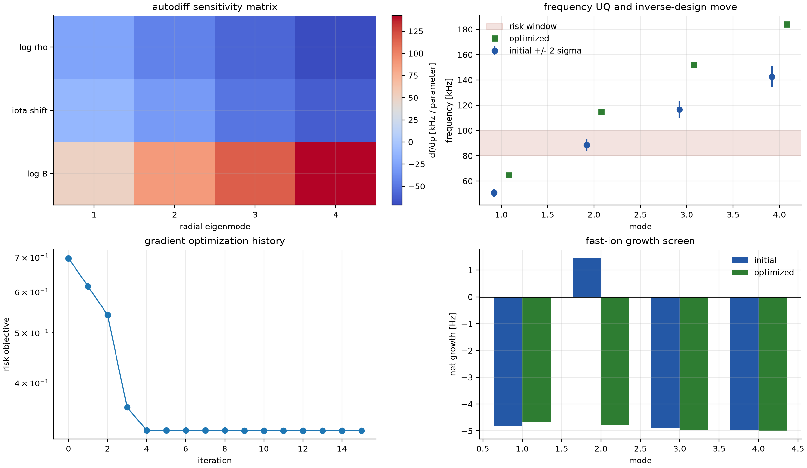

This dashboard is the first end-to-end design-facing FAX workflow: autodiff
sensitivities of global radial eigenfrequencies, linearized UQ bands from
parameter covariance, gradient-based inverse design moving a mode out of a
risk window, and reduced fast-ion growth before/after the differentiable move.
Generate it with `python examples/research/differentiable_design_study.py`.

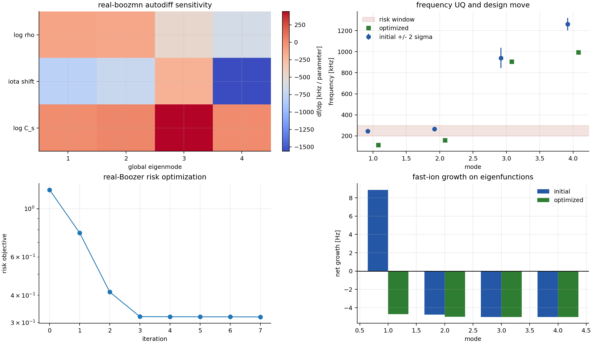

This extends the same workflow to a real `boozmn` global 3-D radial operator.
It differentiates through Boozer local matrices, metric-derived radial
stiffness, generalized eigenfrequencies, and an eigenfunction-projected
fast-ion risk screen. The plotted example moves modes out of a selected
200-300 kHz risk window and turns the peak reduced growth screen negative.

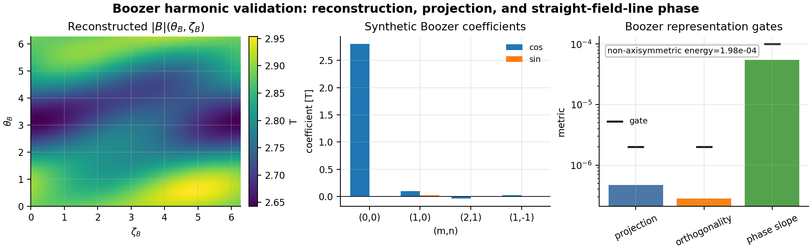

This figure validates Boozer scalar-field representation conventions:
reconstructing `|B|(theta_B,zeta_B)` from harmonics, projecting the sampled
field back to coefficients, checking Fourier orthogonality, and checking the
straight-field-line phase slope `m*iota-n`.

The plotted `|B|` is a synthetic convention stress test, not a
Landreman-Paul QA or quasisymmetric boundary. It is intentionally simple and
non-physical so sign, projection, and phase errors are obvious.

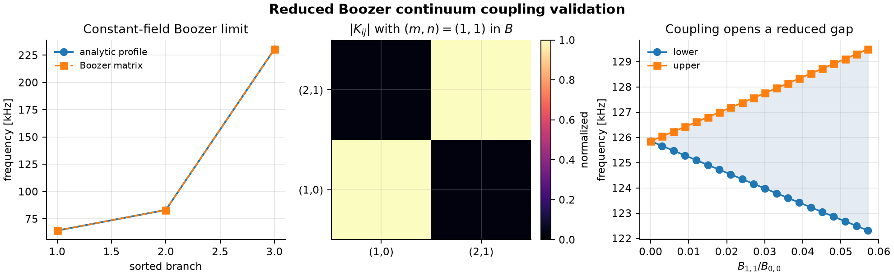

This figure validates the first reduced Boozer continuum matrix: constant
`|B|` recovers the analytic profile limit, a known Boozer harmonic produces
Hermitian sideband coupling, and increasing harmonic amplitude opens a reduced
gap.

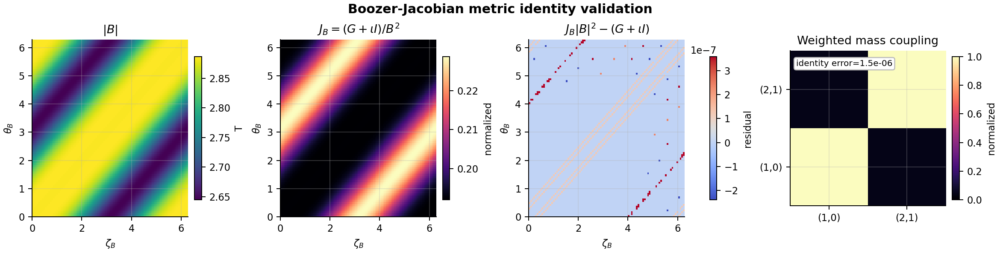

This figure validates the next Boozer metric step: the Boozer-Jacobian identity
`J_B=(G+iota I)/B^2`, the flux-function product `J_B |B|^2`, and the resulting
Jacobian-weighted mass coupling used by the reduced metric bridge.

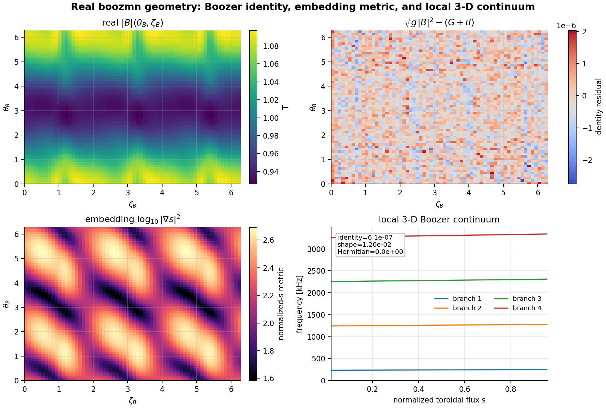

This figure is the first real `boozmn` geometry/operator dashboard: sampled
`|B|`, the file-level Boozer-Jacobian identity residual, the embedding-derived
`|\nabla s|^2` shape, and local 3-D Boozer continuum branches. The fixture is
used to validate asymmetric Boozer harmonic handling and is not a
Landreman-Paul QA quasisymmetry claim.

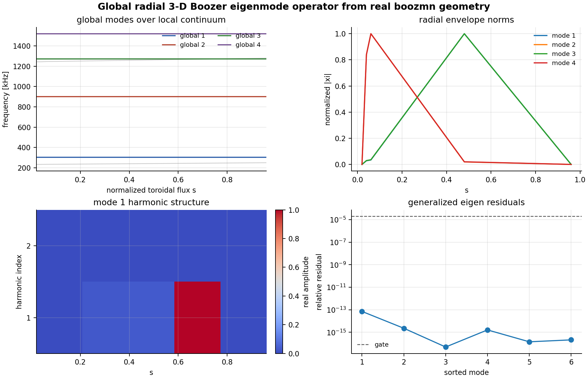

This figure promotes the real-geometry local matrices into a radial block
generalized eigenproblem. Each radial node carries the coupled Boozer harmonic
vector, neighboring surfaces are connected by a Hermitian radial derivative
energy, and the plotted eigenfunctions include both radial envelope and
harmonic content. This closes the global-radial operator lane for the current
shear-Alfvén/Boozer model; broader STELLGAP/AE3D global-mode validation
remains a separate publication gate.

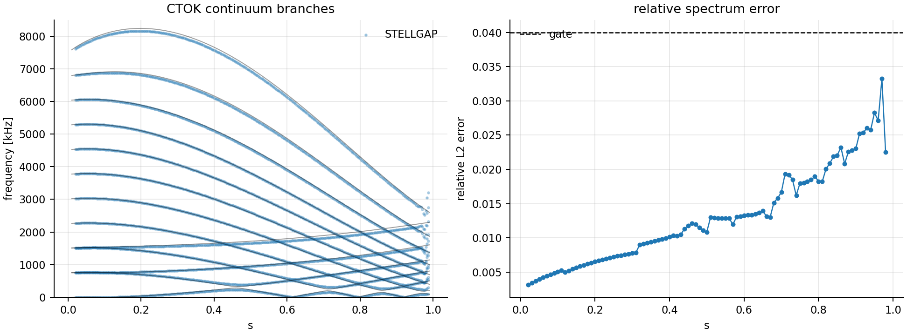

This figure is the first quantitative external-code gate: FAX reads the public
ORNL STELLGAP CTOK `boozmn` fixture, computes local 3-D Boozer continuum
branches, and compares them with STELLGAP `alfven_post` output. The p95
relative spectrum error is about 2.55% over 97 matched surfaces.

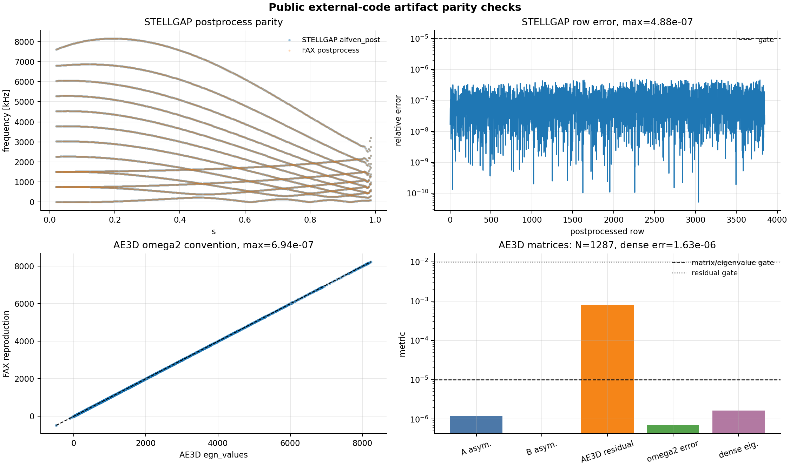

This dashboard adds artifact-level parity checks for public ORNL outputs:
STELLGAP `alfven_spec` post-processing reproduces `alfven_post` to max
relative error `4.9e-7`, AE3D `omega2.dat` reproduces `egn_values.dat` to max
relative error `6.9e-7`, AE3D public sparse matrices are symmetric to the
registered gates, and an independent SciPy/LAPACK solve of AE3D's public
generalized matrix problem recovers the first 16 published eigenvalues to max
relative error about `1.6e-6`. These are prerequisite code-convention gates
before claiming full global AE3D/CAS3D/FAR3D physics parity.

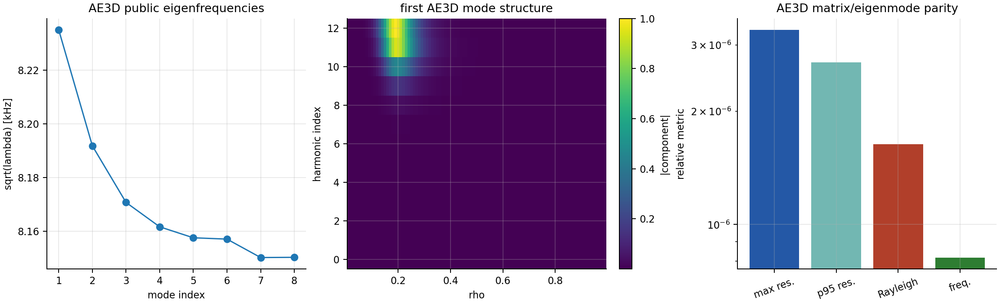

This publication-suite figure reads AE3D public `a_matrix.dat`,
`b_matrix.dat`, and `egn_mode_asci.dat`, reconstructs radial-harmonic mode
structures, and checks `A x = lambda B x` residuals plus Rayleigh-quotient
errors. On the current public artifact set, the first 8 modes have max residual
about `3.3e-6`; an independent dense generalized eigensolve recovers the first
16 published eigenvalues to max relative error about `1.6e-6`.

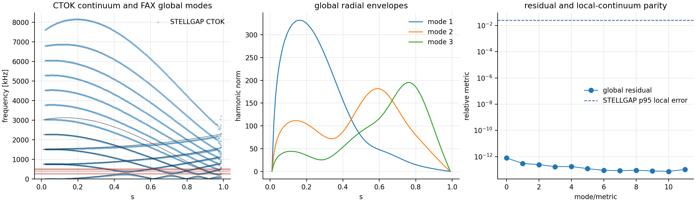

This publication-suite figure overlays public STELLGAP CTOK continuum points,
FAX local Boozer continuum branches, and the current reduced FAX radial global
mode screen. The cross-code claim here is the local-continuum p95 branch error
of about `2.55%`; the global eigenmode overlay is a research workflow screen
awaiting full AE3D/CAS3D/FAR3D operator parity.

Generate the ten-case publication figure packet with:

```bash
python examples/research/publication_figure_suite.py --output-dir outputs/publication_figure_suite
```

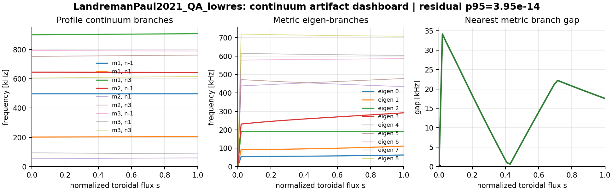

This figure is generated from files written by `fax continuum`: the branch CSV,
summary JSON, and metrics JSON. It checks that user-facing artifacts are
plot-ready and carry the same branch/gap information used by the docs.

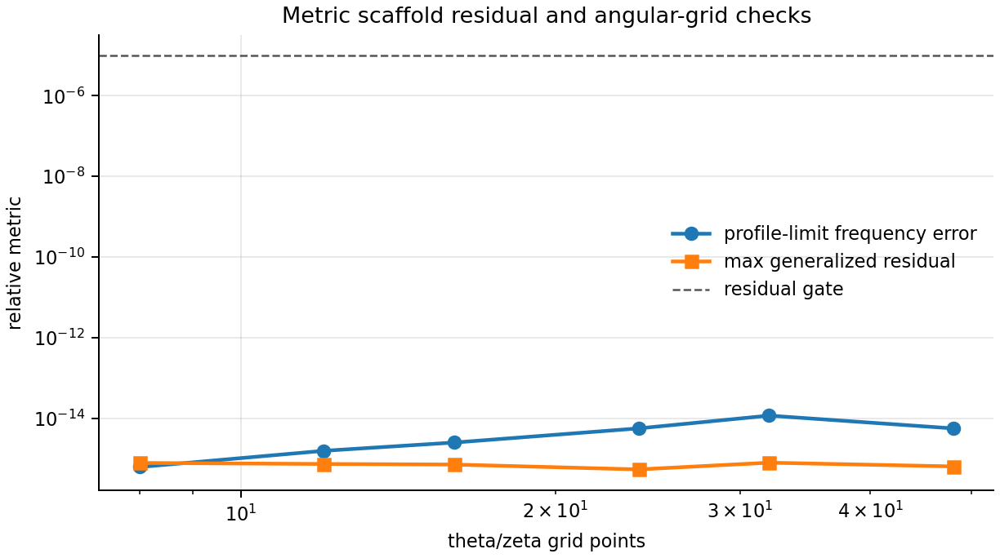

This figure checks the first metric-matrix scaffold: diagonal frequencies
reduce to the profile formula and generalized eigenpairs satisfy
`Kx = lambda Mx` below the residual gate for the tested nonresonant fixture.

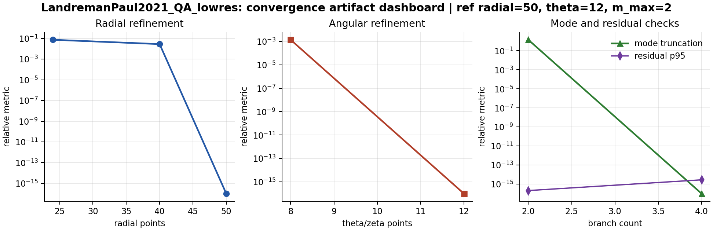

This dashboard is generated from `fax convergence` on the Landreman-Paul QA
lowres adapter path. It shows radial refinement, angular refinement, mode
truncation, and eigensolve residuals for a small VMEC-backed smoke sweep.

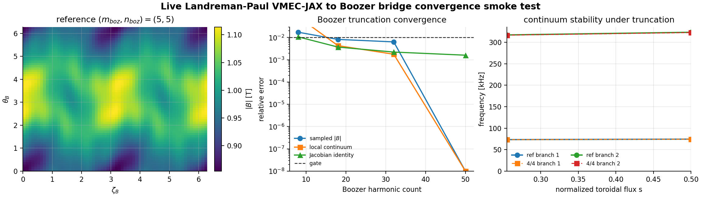

This figure uses the live `vmec_jax -> booz_xform_jax -> FAX` object bridge on
the Landreman-Paul QA input. It holds the same one-iteration VMEC state fixed,
then compares Boozer truncations through sampled `|B|`, local 3-D continuum
frequencies, and the Boozer-Jacobian identity. This is the first convergence
gate on the live bridge, not a converged VMEC physics claim.

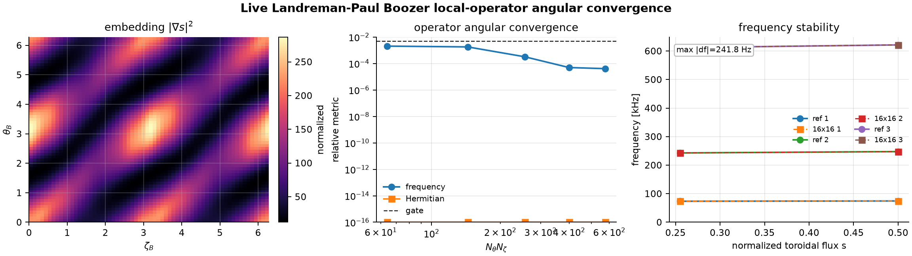

This figure holds the same live Landreman-Paul Boozer geometry fixed and
refines only the angular quadrature used by the local 3-D Boozer operator. It
checks local continuum frequency convergence and Hermiticity against a `32x32`
reference grid.


The validation-gate plot summarizes scaffold acceptance gates. A gate below the
dashed line is within tolerance. These are local scaffold gates; publication
claims still require expanding the current STELLGAP local-continuum comparison
to global AE3D/CAS3D/FAR3D and literature benchmarks.

## Install

After the v0.0.1 release is published to PyPI:

```bash
python -m pip install uwplasma-fax
```

From a local checkout:

```bash
python -m pip install -e .
```

For development:

```bash
python -m pip install -e ".[dev]"
```

For artifact plotting without the full development toolchain:

```bash
python -m pip install -e ".[plots]"
```

The package supports Python 3.10 and newer. On Python 3.10 it uses `tomli` as
the TOML parser fallback; on Python 3.11+ it uses the standard-library
`tomllib`.

The PyPI distribution is `uwplasma-fax` because the `fax` package name is
already occupied on PyPI. The import name and CLI remain `fax`.

## CLI

```bash
fax examples/minimal.toml --dry-run
fax examples/landreman_paul_qa_lowres.toml --dry-run
fax validate examples/minimal.toml --tag analytic
fax continuum examples/landreman_paul_qa_lowres.toml
fax plot-continuum outputs/landreman_paul_qa_lowres --output-dir outputs/landreman_paul_qa_lowres/figures
fax convergence examples/landreman_paul_qa_lowres.toml --radial-points 24 --radial-points 40
fax plot-convergence outputs/landreman_paul_qa_lowres/convergence --output-dir outputs/landreman_paul_qa_lowres/figures
fax benchmark examples/landreman_paul_qa_lowres.toml --repeats 3
python examples/research/basic_alfven_gap_map.py
python examples/research/global_gap_fastion_screen.py
python examples/research/boozer_harmonic_validation.py
python examples/research/boozmn_3d_continuum.py
python examples/research/boozmn_global_3d_eigenmodes.py
python examples/research/stellgap_ctok_comparison.py
```

`fax` reads TOML configuration files. The normal CLI path is intentionally
verbose: it prints solve parameters, phase-by-phase status, elapsed time,
estimated remaining time, individual validation gate start/done lines, and
what the code is doing so long runs do not look silent.

`fax validate` runs the registered validation gates and writes
`validation_summary.json` plus `validation_report.md` in the configured
`run.output_dir`. `fax continuum` computes the current profile and metric-matrix
continuum scaffold, then writes `continuum_summary.json`,
`continuum_metrics.json`, and `continuum_branches.csv`. `fax plot-continuum`
turns those continuum artifacts into SVG/PNG dashboard figures.
`fax convergence` sweeps radial resolution, angular resolution, and Fourier
truncation, then writes a CSV/Markdown/JSON convergence report.
`fax plot-convergence` turns those reports into radial/angular/Fourier
convergence dashboards. `fax benchmark` records cold runtime, warm runtime, and
artifact size for local performance tracking.

For machine-readable output:

```bash
fax examples/minimal.toml --dry-run --json
fax validate examples/minimal.toml --tag metric --json
fax continuum examples/minimal.toml --json
fax plot-continuum outputs --json
fax convergence examples/minimal.toml --radial-points 32 --radial-points 64 --json
fax plot-convergence outputs/convergence --json
fax benchmark examples/minimal.toml --repeats 1 --warmups 0 --json
fax examples/minimal.toml --dump-config
fax examples/minimal.toml --quiet
```

Python calls are also progress-aware:

```python
from fax import load_config, run, run_continuum, run_validation

config = load_config("examples/landreman_paul_qa_lowres.toml")
summary = run(config, progress=True, dry_run=True)
validation = run_validation(config, tags=("metric",), progress=True)
continuum = run_continuum(config, progress=True)
```

The continuum command is still the scaffold model described above: local
profile branches plus the first metric-matrix generalized eigenproblem. It is
useful for adapter checks, diagnostics, and figure generation, while full 3-D
stellarator continuum validation remains planned work.

## Research Examples

Runnable examples are in `examples/`:

```bash
fax continuum examples/analytic_circular_tokamak.toml
fax convergence examples/analytic_convergence.toml --radial-points 16 --radial-points 32 --radial-points 48
python examples/research/validation_packet.py
python examples/research/density_sensitivity.py
python examples/research/inverse_iota_shift.py
python examples/research/global_gap_fastion_screen.py
python examples/research/boozer_harmonic_validation.py
python examples/research/boozmn_3d_continuum.py --boozmn /path/to/boozmn.nc
python examples/research/boozmn_global_3d_eigenmodes.py --boozmn /path/to/boozmn.nc
python examples/research/stellgap_ctok_comparison.py --boozmn /path/to/boozmn_ctok.nc --alfven-post /path/to/alfven_post
```

These generate validation packets, continuum artifacts, convergence dashboards,
JAX sensitivity output, a small inverse-design trace, and real `boozmn` local
3-D Boozer continuum/global-mode plots using the current validated operators,
plus the first public STELLGAP comparison packet when local artifacts exist.

## Figures

Generated figures live in `docs/_static` and are tracked by
`docs/_static/figure_manifest.json`.

Regenerate them with:

```bash
python tools/generate_validation_figures.py
python tools/qa_figures.py
```

Current figures:

- `analytic_continuum_scaling.svg`: analytic large-aspect-ratio continuum smoke test.
- `equations_overview.svg`: implemented equation summary for new users.
- `workflow_io_diagram.svg`: input/operator/output workflow diagram.
- `landreman_paul_qa_lowres_profiles.svg`: first VMEC-backed profile/adapter target.
- `basic_alfven_gap_map.svg`: fast BAE/TAE/EAE large-aspect-ratio continuum example.
- `gap_sensitivity_dashboard.svg`: mode-family, gap-proxy, and autodiff sensitivity dashboard.
- `global_gap_fastion_dashboard.svg`: reduced radial mode, gap, fast-ion, and optimization dashboard.
- `boozer_harmonic_validation.svg`: Boozer harmonic reconstruction/projection and straight-field-line phase dashboard.
- `boozer_continuum_coupling.svg`: reduced Boozer continuum matrix and controlled sideband-coupling dashboard.
- `boozer_jacobian_identity.svg`: Boozer-Jacobian identity and weighted mass-coupling dashboard.
- `boozmn_3d_geometry_operator.svg`: real `boozmn` geometry, Jacobian, embedding metric, and local 3-D Boozer continuum dashboard.
- `boozmn_global_3d_eigenmodes.svg`: global radial 3-D Boozer eigenmode frequencies, envelopes, harmonic structure, and residuals.
- `stellgap_ctok_comparison.svg`: public ORNL STELLGAP CTOK continuum comparison against FAX local 3-D Boozer branches.
- `external_code_artifact_dashboard.svg`: STELLGAP/AE3D public artifact post-processing, eigenvalue-convention, matrix-symmetry, and residual checks.
- `continuum_artifact_dashboard.svg`: dashboard generated from `fax continuum` artifacts.
- `metric_residual_convergence.svg`: metric-matrix residual and angular-grid check.
- `landreman_paul_convergence_dashboard.svg`: VMEC-backed radial/angular/Fourier convergence smoke-test dashboard.
- `vmec_boozer_bridge_convergence.svg`: live `vmec_jax -> booz_xform_jax -> FAX` Boozer truncation convergence smoke-test dashboard.
- `vmec_boozer_operator_angular_convergence.svg`: live Boozer local-operator angular quadrature convergence smoke-test dashboard.
- `validation_gate_summary.svg`: current validation-gate status plot.

## Validation Gates

The current validation registry is available from Python:

```python
from fax.validation import registered_validation_gates, run_validation_suite

for gate in registered_validation_gates():
    print(gate.gate_id, gate.tolerance, gate.citation)

results = run_validation_suite(tags=("metric",))
```

The same registry is available from the CLI:

```bash
fax validate examples/minimal.toml
fax validate examples/minimal.toml --tag metric --json
```

The first gates cover analytic continuum scaling, reduction of the metric
matrix to the profile limit, Hermiticity of the generalized continuum matrices,
generalized eigensolve residuals, density-gradient consistency,
angular/radial-grid consistency, radial quadrature convergence, reduced global
radial spectrum residuals, radial-mode gradient consistency, analytic TAE
gap-center checks, reduced fast-ion resonance ordering, Boozer harmonic
projection/phase convention checks, reduced Boozer continuum matrix checks,
real `boozmn` Jacobian/embedding/local-3-D gates, and Landreman-Paul QA VMEC
adapter plus continuum finite-output/radial-sampling smoke tests. The new
global radial block gates validate a multi-harmonic radial eigenproblem with
Dirichlet and Neumann boundaries, exact constant-coefficient spectra, AD
density scaling, metric-derived Boozer radial stiffness, eigenfunction-weighted
fast-ion drive, file-backed and in-memory `booz_xform_jax` adapter parity,
real-`boozmn` residual checks, and the first public STELLGAP CTOK continuum
comparison. The AE3D public answer table is parsed as an
artifact/residual smoke gate, but not yet as a FAX eigenmode parity claim.
These are acceptance gates for the current operators, not yet full
AE3D/CAS3D/FAR3D stellarator validation.

## Repository Layout

- `plan.md`: literature survey, physics goals, architecture, validation plan,
  milestones, and running handoff log.
- `src/fax`: importable Python package and CLI.
- `docs`: Sphinx/ReadTheDocs source.
- `examples`: runnable TOML examples.
- `tests`: unit tests for the scaffold.
- `.github/workflows`: tests, docs, and PyPI publishing workflows.
- `CHANGELOG.md`: release history.
- `.github/release_notes`: GitHub release notes used for tagged releases.

## Current Scope

The implementation deliberately avoids pretending the full physics model exists.
It currently establishes:

- installable package metadata with unpinned library dependencies,
- a TOML-driven `fax` command,
- ReadTheDocs-ready documentation,
- GitHub Actions for tests, docs, and PyPI publishing,
- local-only quality gates while GitHub Actions billing is blocked,
- unit tests for configuration, CLI, reference cases, continuum formulas,
  metric matrices, gradients, validation gates, and benchmark helpers,
- a LandremanPaul2021 QA lowres local reference target,
- real `boozmn` geometry gates for Boozer Jacobian identity, embedding
  Jacobian shape, and local 3-D surface continuum matrices,
- file-backed and in-memory `booz_xform_jax` adapters that populate the same
  FAX `BoozerGeometry` contract from VMEC `wout` data,
- a live one-iteration `vmec_jax -> booz_xform_jax -> FAX` Landreman-Paul QA
  bridge gate that verifies object handoff, the Boozer Jacobian identity, and
  finite local 3-D continuum branches without claiming converged VMEC physics,
- a live-bridge Boozer truncation convergence gate comparing `(mboz,nboz)=(4,4)`
  against `(5,5)` on the same in-memory VMEC state,
- a live-bridge local-operator angular convergence gate comparing `12x12`,
  `16x16`, and `20x20` angular quadrature against a `32x32` reference grid,
- a global radial 3-D Boozer block eigenmode operator with radial envelopes,
  harmonic mode structures, residual diagnostics, and analytic constant-limit
  gates,
- metric-derived Boozer radial stiffness, Dirichlet/Neumann block boundary
  gates, eigenfunction-weighted fast-ion drive diagnostics, and a differentiable
  Boozer global-mode avoidance objective with a builder-based API for future
  `vmec_jax`/`booz_xform_jax` end-to-end pipelines,
- a public STELLGAP CTOK local-continuum comparison gate and figure, plus AE3D
  public matrix/eigenmode and independent dense-spectrum parity gates,
- generated smoke-test figures for docs and README,
- a reduced radial global eigenmode operator, analytic gap estimates, reduced
  fast-ion resonance screens, and differentiable design objective,
- a handoff plan grounded in the existing literature and comparison codes.

## Local Quality Gate

Until GitHub Actions resumes, every pushed change should pass locally:

```bash
python -m ruff check .
python -m mypy src/fax
python -m pytest
sphinx-build -W -b html docs docs/_build/html
python tools/generate_validation_figures.py
python tools/qa_figures.py
python -m build
```
