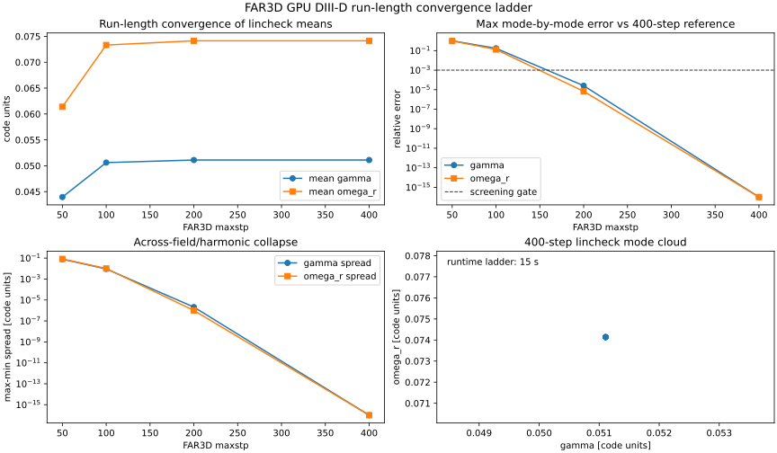

External Code Runs
==================

FAX treats external codes as versioned benchmark producers. A successful build
or parser run is useful, but it is not the same claim as physics parity. The
current external-code status is therefore split into three levels:

* executable/runtime trace: the external code was built and ran on recorded
  hardware;
* artifact parity: FAX reproduces a documented external-code output convention
  or matrix/eigenmode artifact;
* physics parity: FAX's native operator reproduces the external code on matched
  geometry, basis, normalization, boundary conditions, and tolerances.

Current FAR3D GPU Run
---------------------

On 2026-04-30, FAR3D was built and run on the ``office`` GPU host using the
public ``DSfusion/FAR3d`` repository at commit ``c76bdfe``. The host has two
NVIDIA RTX A4000 GPUs. The successful build used a user-space, minimally
extracted NVIDIA HPC SDK 25.9 CUDA-Fortran toolchain because the full SDK
installer exceeded the available filesystem space and the system compiler did
not provide ``cudafor.mod``.

Build recipe used on ``office``:

.. code-block:: bash

   export NVCOMPILERS=$HOME/local/nvidia/hpc_sdk
   export COMPILERS=$NVCOMPILERS/Linux_x86_64/25.9/compilers
   export COMM=$NVCOMPILERS/Linux_x86_64/25.9/comm_libs
   export CUDA_LIB=$NVCOMPILERS/Linux_x86_64/25.9/cuda/13.0/targets/x86_64-linux/lib
   export MATH_LIB=$NVCOMPILERS/Linux_x86_64/25.9/math_libs/13.0/targets/x86_64-linux/lib
   export PATH=$COMPILERS/bin:$COMM/hpcx/bin:/usr/local/bin:/usr/bin:/bin
   export LD_LIBRARY_PATH=$COMPILERS/lib:$CUDA_LIB:$MATH_LIB:$LD_LIBRARY_PATH

   cd ~/local/FAR3d
   git checkout -- src/matrix.f90
   rm -rf build-gpu-nvhpc
   ~/miniforge3/envs/qh-gpu/bin/cmake -S . -B build-gpu-nvhpc \
     -DCMAKE_BUILD_TYPE=Release \
     -DCMAKE_C_COMPILER=$(command -v mpicc) \
     -DCMAKE_Fortran_COMPILER=$(command -v mpif90) \
     -DCMAKE_Fortran_FLAGS="-O3 -mp -acc=gpu -gpu=mem:managed -Minstrument -traceback -cuda" \
     -DCMAKE_EXE_LINKER_FLAGS="-cuda"
   ~/miniforge3/envs/qh-gpu/bin/cmake --build build-gpu-nvhpc -j2

The direct singleton launch reached the executable but stalled in MPI startup.
The successful run used the extracted HPC-X OpenMPI prefix explicitly:

.. code-block:: bash

   export HPCX=$NVCOMPILERS/Linux_x86_64/25.9/comm_libs/13.0/hpcx/hpcx-2.24
   export OPAL_PREFIX=$HPCX/ompi
   export COMPILERS=$NVCOMPILERS/Linux_x86_64/25.9/compilers
   export COMM=$NVCOMPILERS/Linux_x86_64/25.9/comm_libs
   export CUDA_LIB=$NVCOMPILERS/Linux_x86_64/25.9/cuda/13.0/targets/x86_64-linux/lib
   export MATH_LIB=$NVCOMPILERS/Linux_x86_64/25.9/math_libs/13.0/targets/x86_64-linux/lib
   export PATH=$COMPILERS/bin:$HPCX/ompi/bin:$COMM/hpcx/bin:/usr/local/bin:/usr/bin:/bin
   export LD_LIBRARY_PATH=$COMPILERS/lib:$CUDA_LIB:$MATH_LIB:$HPCX/ompi/lib:$HPCX/ucx/lib:$HPCX/ucc/lib:$HPCX/hcoll/lib:$HPCX/sharp/lib:$LD_LIBRARY_PATH
   export CUDA_VISIBLE_DEVICES=0
   export OMPI_MCA_btl=self,tcp
   export OMPI_MCA_pml=ob1

   cd ~/local/far3d_runs/diiid_gpu_nvhpc
   timeout 300 mpirun -np 1 --prefix "$OPAL_PREFIX" ./far3d.x

The short run used a translated current-format ``farin`` file for the public
DIII-D ``Eq_DIIID_RS`` example and ``maxstp=20``. It produced ``farprt0000``,
field snapshots, spectra, profile output, and restart files in about two
seconds. The archived FAX artifacts are:

* ``external_artifacts/far3d/gpu_diiid_nvhpc/farin``
* ``external_artifacts/far3d/gpu_diiid_nvhpc/farprt0000``
* ``external_artifacts/far3d/gpu_diiid_nvhpc/kinetic_dataset.json``
* ``external_artifacts/far3d/gpu_diiid_nvhpc/profiles.dat``
* ``external_artifacts/far3d/gpu_diiid_nvhpc/spctr_0000``

The FAR3D output reported:

.. code-block:: text

   Conversion factor from code frequency to kHz:   5.9981341E+02

FAX therefore ingests the ``lincheck`` rows with
``frequency_scale_hz = growth_rate_scale_hz = 599813.41`` for this artifact.
That conversion is recorded in the JSON packet, but the packet is still a
runtime/ingestion artifact. It is not a calibrated kinetic growth-rate parity
case because the run is short and not a documented converged FAR3D benchmark.

.. figure:: _static/far3d_gpu_lincheck_artifact.svg
   :alt: FAR3D GPU lincheck artifact dashboard.

   FAR3D GPU DIII-D public-example ``lincheck`` artifact. The dashboard shows
   parsed growth and frequency estimates from the real run output and supports
   the parser/runtime trace. It does not claim calibrated FAR3D kinetic parity.

Regenerate the figure with:

.. code-block:: bash

   python examples/research/far3d_gpu_lincheck_artifact.py --output-dir docs/_static

Next FAR3D parity steps:

* run a longer linear case to converged growth-rate estimates,
* record complete input, output, commit, compiler, MPI, GPU, and runtime
  metadata,
* compare FAX reduced fast-ion closure predictions against FAR3D growth rates
  with calibration and held-out validation splits,
* repeat on at least one stellarator case before making broad fast-ion claims.

FAR3D Run-Length Convergence Ladder
-----------------------------------

The next FAR3D step was a bounded run-length ladder on the same GPU executable
and public DIII-D input. Runs with ``maxstp = 50, 100, 200, 400`` were archived
under ``external_artifacts/far3d/gpu_diiid_nvhpc_convergence``. The full ladder
ran in 15 seconds total on ``office``.

The key result is that the 200-step output is already close to the 400-step
reference for this small case:

* maximum mode-by-mode relative ``gam`` difference: ``2.6e-5``;
* maximum mode-by-mode relative ``om_r`` difference: ``6.8e-6``;
* 400-step across-field/harmonic spread: zero at the printed FAR3D precision.

   FAR3D GPU run-length convergence for the public DIII-D example. This is a
   single-case convergence artifact that identifies a stable ``lincheck`` run
   length for future parity work; it is still not a multi-geometry kinetic
   benchmark or a calibrated fast-ion validation.

Regenerate the figure with:

.. code-block:: bash

   python examples/research/far3d_gpu_convergence_ladder.py --output-dir docs/_static
