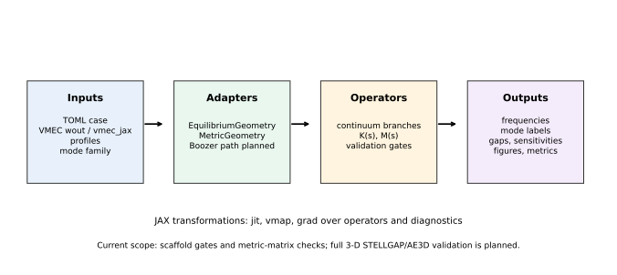
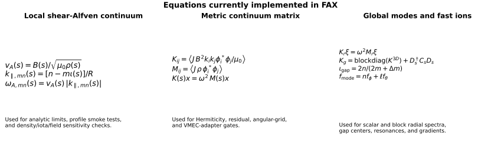
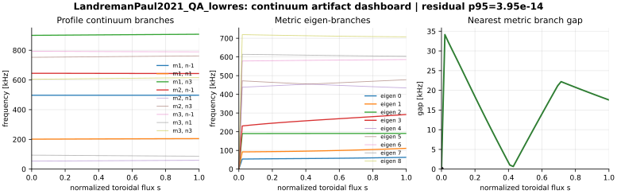
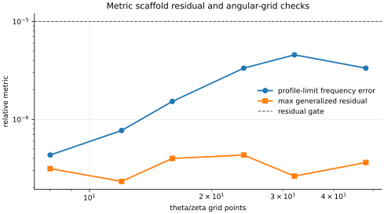
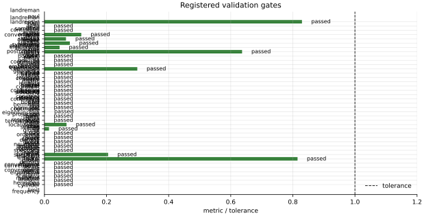

Figure Plan
===========

Figures in ``fax`` must be generated by scripts and tied to explicit claims.
The current generator is:

.. code-block:: bash

   python tools/generate_validation_figures.py
   python tools/qa_figures.py

Current Figures
---------------

   New-user workflow diagram showing TOML/equilibrium/profile inputs, adapters,
   current operators, and output artifacts.

   Implemented local-continuum and metric-matrix equations.

.. figure:: _static/analytic_continuum_scaling.svg
   :alt: Analytic large-aspect-ratio continuum smoke-test branches.

   Analytic large-aspect-ratio continuum branches. This supports formula,
   scaling, and differentiability smoke tests.

.. figure:: _static/landreman_paul_qa_lowres_profiles.svg
   :alt: LandremanPaul2021 QA lowres profiles and local continuum branches.

   First VMEC-backed local reference target. This is a profile/adapter and
   local-continuum smoke test, not full 3-D continuum validation.

.. figure:: _static/gap_sensitivity_dashboard.svg
   :alt: Gap and sensitivity dashboard for the LandremanPaul2021 QA lowres smoke test.

   Prototype dashboard for README/docs: mode-family branches, nearest-branch
   separation, and autodiff sensitivities.

   Dashboard generated from files written by ``fax continuum``. This checks the
   public artifact path used by users and downstream plotting scripts.

   Metric-matrix scaffold residual and angular-grid checks. The residual curve
   verifies the dense generalized Hermitian eigensolver on a nonresonant
   analytic fixture.

.. figure:: _static/landreman_paul_convergence_dashboard.svg
   :alt: LandremanPaul2021 QA convergence dashboard.

   VMEC-backed adapter convergence dashboard generated by ``fax convergence``
   for radial, angular, Fourier, and residual smoke checks.

   Current scaffold validation gates shown as metric/tolerance ratios.

Figure QA
---------

``tools/qa_figures.py`` parses SVG files and inspects rendered PNG files for
reasonable dimensions and non-white pixel coverage. This catches blank README
figures and malformed generated artifacts before commits.

Planned Publication Figures
---------------------------

1. Analytic cylinder and tokamak continuum validation with convergence.
2. LandremanPaul2021 QA full VMEC/Boozer metric continuum map.
3. STELLGAP or AE3D cross-code comparison with branch/gap error bars.
4. Gradient correctness figure: finite difference, direct AD, and custom adjoint.
5. Runtime scaling figure: compile time, warm runtime, memory, and resolution.
6. Inverse-design demonstration with before/after continuum-risk dashboard.

Every publication figure must have a source command, input hash, tolerance, and
claim statement.
