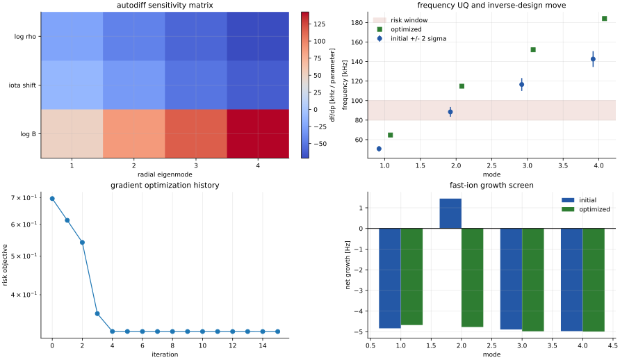
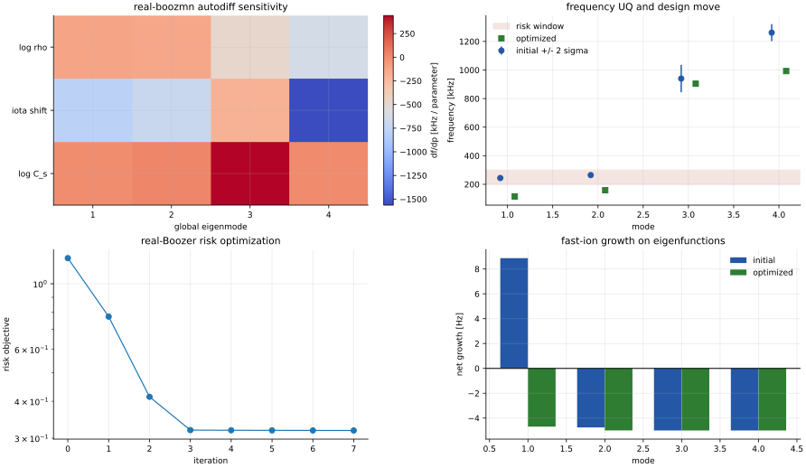

Figure Plan
===========

Figures in ``fax`` must be generated by scripts and tied to explicit claims.
The current generator is:

.. code-block:: bash

   python tools/generate_validation_figures.py
   python tools/qa_figures.py

Current Figures
---------------

.. figure:: _static/workflow_io_diagram.svg
   :alt: FAX input, adapter, operator, and output workflow.

   New-user workflow diagram showing TOML/equilibrium/profile inputs, adapters,
   current operators, and output artifacts.

.. figure:: _static/equations_overview.svg
   :alt: Equations currently implemented in FAX.

   Implemented local-continuum and metric-matrix equations.

.. figure:: _static/analytic_continuum_scaling.svg
   :alt: Analytic large-aspect-ratio continuum smoke-test branches.

   Analytic large-aspect-ratio continuum branches. This supports formula,
   scaling, and differentiability smoke tests.

.. figure:: _static/landreman_paul_qa_lowres_profiles.svg
   :alt: LandremanPaul2021 QA lowres profiles and local continuum branches.

   First VMEC-backed local reference target. This is a profile/adapter and
   local-continuum smoke test, not full 3-D continuum validation.

.. figure:: _static/basic_alfven_gap_map.svg
   :alt: Basic BAE, TAE, and EAE Alfvén-continuum gap map.

   Fast analytic large-aspect-ratio gap example: cylindrical continuum
   branches, a TAE avoided crossing from ``m,m+1`` coupling, an EAE avoided
   crossing from ``m,m+2`` coupling, and a low-frequency BAE accumulation
   marker.

.. figure:: _static/gap_sensitivity_dashboard.svg
   :alt: Gap and sensitivity dashboard for the LandremanPaul2021 QA lowres smoke test.

   Prototype dashboard for README/docs: mode-family branches, nearest-branch
   separation, and autodiff sensitivities.

.. figure:: _static/global_gap_fastion_dashboard.svg
   :alt: Reduced global-mode, gap, fast-ion, and optimization dashboard.

   Reduced global-mode, gap-center, fast-ion resonance, and optimization
   gradient dashboard. The top-left panel is tied to an exact finite-difference
   spectrum gate; the bottom panels are analytic/reduced screening diagnostics.

   Integrated differentiable design dashboard: frequency sensitivity matrix,
   linearized UQ bands, inverse-design objective history, and reduced fast-ion
   growth before/after optimization.

   Real ``boozmn`` differentiable design dashboard: frequency sensitivities,
   UQ bands, risk-objective history, and eigenfunction-projected fast-ion
   growth before/after the design move.

.. figure:: _static/boozer_harmonic_validation.svg
   :alt: Boozer harmonic reconstruction and straight-field-line validation.

   Boozer ``|B|`` harmonic map, coefficient bars, projection/orthogonality
   gates, and straight-field-line phase-slope gate. This is a synthetic
   convention stress test, not a quasisymmetric equilibrium boundary.

.. figure:: _static/boozer_continuum_coupling.svg
   :alt: Reduced Boozer continuum coupling validation.

   Reduced Boozer continuum matrix dashboard: constant-field profile-limit
   recovery, sideband-coupling matrix, and controlled gap opening with
   increasing Boozer harmonic amplitude.

.. figure:: _static/boozer_jacobian_identity.svg
   :alt: Boozer-Jacobian identity validation dashboard.

   Boozer-Jacobian metric identity dashboard: sampled ``|B|``,
   ``J_B=(G+iota I)/B^2``, the flux-function product ``J_B |B|^2``, and
   weighted mass coupling.

.. figure:: _static/boozmn_3d_geometry_operator.svg
   :alt: Real boozmn geometry and local 3-D Boozer continuum dashboard.

   Real ``boozmn`` geometry dashboard: sampled ``|B|``, the file-level
   Boozer-Jacobian identity residual, embedding-derived ``|\\nabla s|^2``,
   and local 3-D Boozer continuum branches. The fixture is a geometry/operator
   validation target, not a Landreman-Paul QA quasisymmetry claim.

.. figure:: _static/boozmn_global_3d_eigenmodes.svg
   :alt: Global radial 3-D Boozer eigenmode dashboard.

   Global radial 3-D Boozer eigenmode dashboard: local continuum branches,
   global radial eigenfrequencies, radial envelope norms, harmonic content, and
   residual gates. This is the first full radial block operator figure in FAX.

.. figure:: _static/stellgap_ctok_comparison.svg
   :alt: STELLGAP CTOK continuum comparison.

   First public cross-code comparison dashboard: FAX local 3-D Boozer
   continuum branches overlaid on ORNL STELLGAP CTOK output, with a radial
   spectrum-error panel.

.. figure:: _static/external_code_artifact_dashboard.svg
   :alt: STELLGAP and AE3D public artifact parity dashboard.

   Artifact-level public-code checks: FAX reproduces STELLGAP
   ``alfven_spec`` to ``alfven_post`` post-processing, reproduces AE3D
   ``omega2.dat`` to ``egn_values.dat`` conventions, checks AE3D sparse
   matrix symmetry/residual metrics, and independently re-solves the public
   AE3D generalized matrix problem. These are convention gates that precede
   full global-mode physics parity.

.. figure:: _static/continuum_artifact_dashboard.svg
   :alt: Dashboard generated from fax continuum artifacts.

   Dashboard generated from files written by ``fax continuum``. This checks the
   public artifact path used by users and downstream plotting scripts.

.. figure:: _static/metric_residual_convergence.svg
   :alt: Metric residual and angular-grid convergence checks.

   Metric-matrix scaffold residual and angular-grid checks. The residual curve
   verifies the dense generalized Hermitian eigensolver on a nonresonant
   analytic fixture.

.. figure:: _static/landreman_paul_convergence_dashboard.svg
   :alt: LandremanPaul2021 QA convergence dashboard.

   VMEC-backed adapter convergence dashboard generated by ``fax convergence``
   and plotted through ``fax plot-convergence`` for radial, angular, Fourier,
   and residual smoke checks.

.. figure:: _static/vmec_boozer_bridge_convergence.svg
   :alt: Live VMEC-JAX to Boozer bridge truncation convergence dashboard.

   Live Landreman-Paul ``vmec_jax`` to ``booz_xform_jax`` bridge convergence
   dashboard. It holds one VMEC state fixed and compares Boozer truncations
   through sampled ``|B|``, local 3-D continuum frequencies, and the
   Boozer-Jacobian identity.

.. figure:: _static/vmec_jax_solve_convergence.svg
   :alt: VMEC-JAX solve convergence propagated through Boozer/FAX.

   Live Landreman-Paul ``vmec_jax`` solve-convergence ladder. VMEC force
   residuals, Boozer field/Jacobian errors, FAX continuum frequency errors,
   and local runtimes are tracked against the converged reference ``wout``.

.. figure:: _static/vmec_boozer_operator_angular_convergence.svg
   :alt: Live VMEC-JAX Boozer local-operator angular convergence dashboard.

   Live Landreman-Paul Boozer local-operator angular convergence dashboard.
   It holds the Boozer geometry fixed and refines only the angular quadrature
   used by the local 3-D surface operator.

.. figure:: _static/validation_gate_summary.svg
   :alt: Registered validation-gate summary.

   Current scaffold validation gates shown as metric/tolerance ratios.

Figure QA
---------

``tools/qa_figures.py`` parses SVG files and inspects rendered PNG files for
reasonable dimensions and non-white pixel coverage. This catches blank README
figures and malformed generated artifacts before commits.

Planned Publication Figures
---------------------------

1. Analytic cylinder and tokamak continuum validation with convergence.
2. LandremanPaul2021 QA full VMEC/Boozer metric continuum map.
3. STELLGAP or AE3D cross-code comparison with branch/gap error bars.
4. Boundary-condition comparison figure for Dirichlet/Neumann/radiation variants.
5. Gradient correctness figure: finite difference, direct AD, and custom adjoint.
6. Runtime scaling figure: compile time, warm runtime, memory, and resolution.
7. Inverse-design demonstration with before/after continuum-risk dashboard.

Every publication figure must have a source command, input hash, tolerance, and
claim statement.
