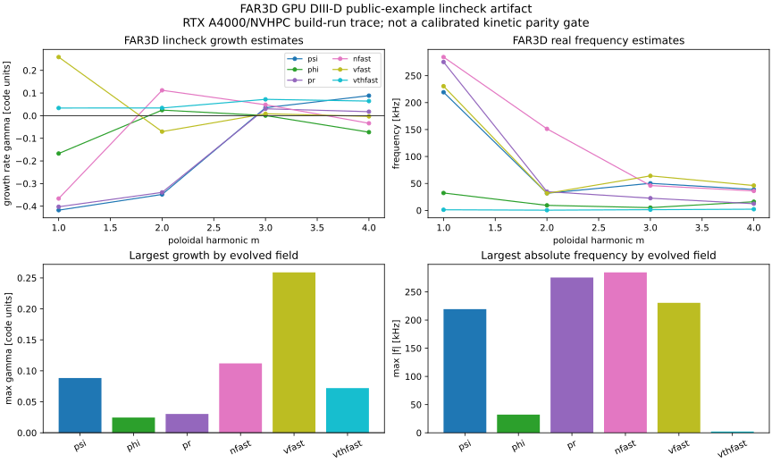
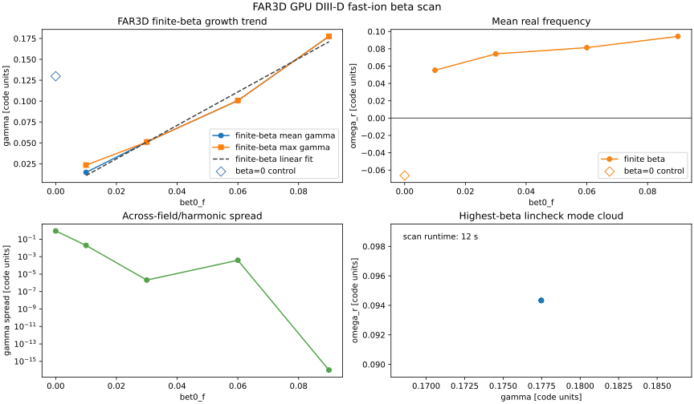

Kinetic Growth-Rate Validation
==============================

FAX still treats fast-ion growth/damping as a reduced screening and
calibration layer until FAR3D/CAS3D-K parity is closed. The first concrete step
toward that lane is a machine-readable growth-rate benchmark contract:

* each case records the source code or literature source, geometry, mode ID,
  toroidal mode, frequency, growth rate, uncertainty, distribution parameters,
  and whether it is a calibration or held-out validation case;
* parity metrics are computed on the held-out validation split, not only on
  fitted cases;
* the CLI returns a failing status when validation data are missing or outside
  tolerance;
* the weighted growth-rate loss is JAX differentiable, so calibrated closure
  studies can be embedded in inverse design and uncertainty workflows.

Command-Line Gate
-----------------

Prepare a JSON dataset and a prediction JSON file:

.. code-block:: json

   {
     "dataset_id": "far3d_cas3dk_growth_rates_v1",
     "citation": "FAR3D/CAS3D-K benchmark packet with archived input/output hashes",
     "cases": [
       {
         "case_id": "far3d_train_core",
         "source_code": "FAR3D",
         "geometry_id": "qa_lowres",
         "mode_id": "n1_core_tae",
         "frequency_hz": 72000.0,
         "growth_rate_hz": 120.0,
         "growth_rate_uncertainty_hz": 12.0,
         "toroidal_mode": 1,
         "split": "calibration",
         "resonance_radius": 0.42,
         "distribution_parameters": {"beta_fast": 0.01, "v_alpha_over_va": 1.1}
       },
       {
         "case_id": "cas3dk_validation_stable",
         "source_code": "CAS3D-K",
         "geometry_id": "heldout_qh",
         "mode_id": "n2_stable_gap",
         "frequency_hz": 146000.0,
         "growth_rate_hz": -25.0,
         "growth_rate_uncertainty_hz": 5.0,
         "toroidal_mode": 2,
         "split": "validation"
       }
     ]
   }

Predictions can be supplied by case ID:

.. code-block:: json

   {
     "far3d_train_core": 124.0,
     "cas3dk_validation_stable": -27.0
   }

Run the gate:

.. code-block:: bash

   fax kinetic-parity kinetic_dataset.json predictions.json
   fax kinetic-parity kinetic_dataset.json predictions.json --json

FAR3D Ingestion
---------------

FAR3D writes linear growth/frequency estimates in its ``lincheck`` diagnostic
using native normalized units. FAX can now parse those rows directly, but it
requires an explicit normalization scale before producing a Hz-based validation
packet:

.. code-block:: bash

   fax far3d-ingest far3d.out \
     --dataset-id far3d_ctok_linear_v1 \
     --geometry-id ctok \
     --frequency-scale-hz 2.0e6 \
     --growth-rate-scale-hz 2.0e6 \
     --variable psi \
     --output kinetic_dataset.json

This command parses rows of the form:

.. code-block:: text

   psi     : m=   4 n=   1 gam=  1.23456E-03 om_r=  5.67890E-02

and records both the converted values and the original FAR3D ``gam``/``om_r``
code-unit values in each case note. The normalization is intentionally explicit:
until a FAR3D benchmark packet documents its input, output, and unit conversion,
the resulting JSON is an ingestion artifact, not a completed kinetic parity
claim.

Archived FAR3D GPU Artifact
---------------------------

The repository now includes the first real FAR3D executable-run artifact:
``external_artifacts/far3d/gpu_diiid_nvhpc/farprt0000``. It was generated on
the ``office`` GPU host from ``DSfusion/FAR3d`` commit ``c76bdfe`` using a
CUDA-Fortran/NVHPC build and the public DIII-D ``Eq_DIIID_RS`` example adapted
to FAR3D's current ``farin`` namelist format.

The run reported ``599.81341 kHz`` per FAR3D code-frequency unit. FAX therefore
archives a parser-ready kinetic dataset at
``external_artifacts/far3d/gpu_diiid_nvhpc/kinetic_dataset.json`` with
``frequency_scale_hz = growth_rate_scale_hz = 599813.41``.

Regenerate the ingestion packet with:

.. code-block:: bash

   fax far3d-ingest external_artifacts/far3d/gpu_diiid_nvhpc/farprt0000 \
     --dataset-id far3d_diiid_gpu_nvhpc_20step \
     --geometry-id diiid_rs_public_example \
     --frequency-scale-hz 599813.41 \
     --growth-rate-scale-hz 599813.41 \
     --relative-growth-rate-uncertainty 0.2 \
     --output external_artifacts/far3d/gpu_diiid_nvhpc/kinetic_dataset.json

   Parsed ``lincheck`` growth and frequency estimates from the real FAR3D GPU
   run. This closes the FAR3D build/run/parser traceability step; it is not yet
   a converged growth-rate parity result.

The same executable/input pair now has an archived run-length ladder at
``external_artifacts/far3d/gpu_diiid_nvhpc_convergence``. The 200-step
``lincheck`` rows agree with the 400-step reference to ``2.6e-5`` in maximum
relative growth-rate difference and ``6.8e-6`` in maximum relative frequency
difference for common mode labels. This is a useful convergence screen for
future FAR3D parity packets, but it is still one DIII-D case and not a
multi-geometry kinetic validation set.

The first parameter scan using that run length is archived under
``external_artifacts/far3d/gpu_diiid_nvhpc_beta_scan``. It scans
``bet0_f = 0.000, 0.010, 0.030, 0.060, 0.090`` and checks that the finite-beta
branch has monotonically increasing mean ``lincheck`` growth:

   FAR3D finite-beta growth trend for the public DIII-D example. The
   ``bet0_f = 0`` point is flagged as a control because its printed growth
   estimates have a large across-field/harmonic spread. The finite-beta trend
   is a useful next calibration target, but this is not yet a held-out
   FAX-vs-FAR3D kinetic parity result.

Python API
----------

.. code-block:: python

   import jax
   import jax.numpy as jnp
   from fax import (
       kinetic_growth_rate_loss,
       kinetic_growth_rate_parity,
       load_kinetic_growth_rate_dataset,
   )

   dataset = load_kinetic_growth_rate_dataset("kinetic_dataset.json")
   predicted = jnp.asarray([124.0, -27.0])
   report = kinetic_growth_rate_parity(dataset, predicted)
   gradient = jax.grad(lambda scale: kinetic_growth_rate_loss(scale * predicted, dataset.growth_rate_hz, dataset.growth_rate_uncertainty_hz))(1.0)

FAR3D output can be ingested from Python:

.. code-block:: python

   from fax import load_far3d_lincheck_dataset, read_far3d_lincheck

   rows = read_far3d_lincheck("far3d.out", variables=("psi", "nfast"))
   dataset = load_far3d_lincheck_dataset(
       "far3d.out",
       dataset_id="far3d_ctok_linear_v1",
       geometry_id="ctok",
       frequency_scale_hz=2.0e6,
       variables=("psi", "nfast"),
   )

The report is a validation contract. It does not turn the current reduced
gyro-Landau closure into a kinetic-code replacement until real FAR3D/CAS3D-K
calibration and held-out validation datasets pass documented tolerances.
