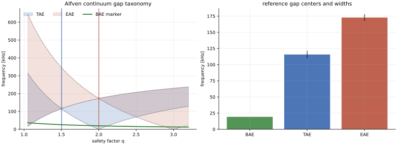
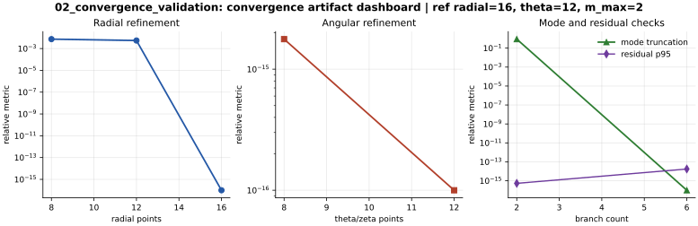
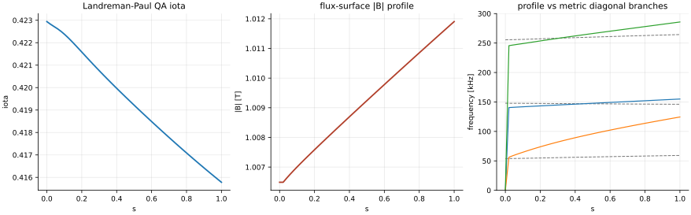
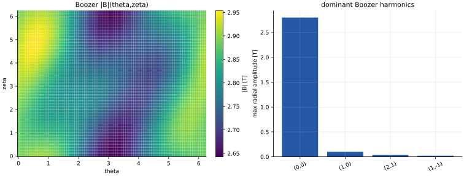
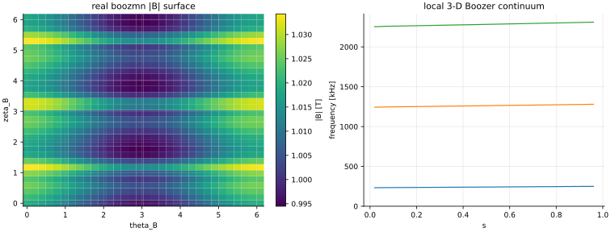
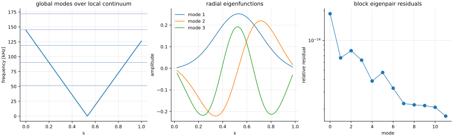
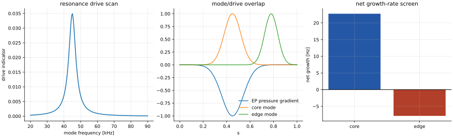
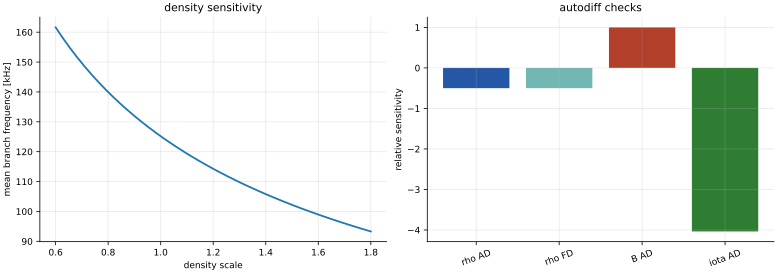
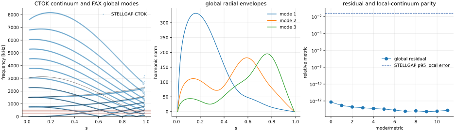
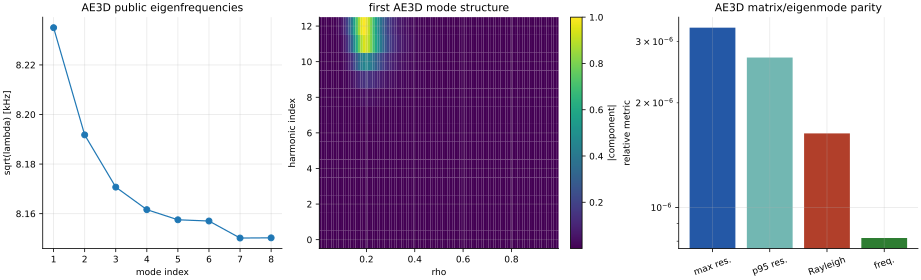

Publication Results
===================

This page is the v0.0.1 publication-readiness packet for FAX. It gathers the
figures, numerical gates, commands, claim levels, and remaining limitations in
one place so a paper draft or review handoff can point to a single source of
truth.

Regenerate the complete publication figure suite with:

.. code-block:: bash

   python examples/research/publication_figure_suite.py --output-dir docs/_static/publication_suite
   python tools/generate_validation_figures.py
   python tools/qa_figures.py --figure-dir docs/_static
   python tools/qa_figures.py --figure-dir docs/_static/publication_suite

The suite currently contains ten completed SVG/PNG figure pairs plus JSON
metrics in ``docs/_static/publication_suite/publication_figure_suite_summary.json``.
Each figure below states what it supports and what it does not support.

Claim Levels
------------

``validated analytic limit``
   Exact formulas, residual gates, and convergence checks protect the plotted
   result.

``validated operator diagnostic``
   The discrete operator passes Hermiticity, residual, convergence, or
   limiting-case gates, but may still be a reduced model.

``artifact or matrix parity``
   FAX reproduces a published external-code artifact, convention, matrix,
   eigenvalue, or eigenvector. This does not imply full native-operator parity.

``screening application``
   A real workflow is exercised end to end, but additional cross-code or
   kinetic validation is required before making final physics claims.

Figure Suite
------------

   **Validated analytic limit.** Large-aspect-ratio BAE, TAE, and EAE gap
   markers are shown with the expected reference surfaces. The current metrics
   place the TAE marker at ``q=1.5017`` and the EAE marker at ``q=2.0003``.

   **Validated analytic/operator diagnostic.** The figure combines continuum
   convergence and generalized-eigen residual checks. Current p95 residuals are
   at machine precision and the maximum frequency L2 error in the summary is
   ``7.32e-3`` for the shown deliberately small resolution ladder.

   **Screening application.** The Landreman-Paul QA low-resolution VMEC
   ``wout`` path is exercised through FAX profile and local-continuum
   diagnostics. This is an adapter and smoke-test figure, not a final
   high-resolution quasisymmetric-continuum validation.

   **Validated operator diagnostic.** Boozer harmonic reconstruction,
   projection, Fourier orthogonality, and straight-field-line phase conventions
   are checked. Current projection and orthogonality errors are near roundoff.

   **Validated operator diagnostic.** The real-Boozer local 3-D surface
   continuum matrix is evaluated over five surfaces with Hermitian and
   finite-output checks. It validates the local reduced operator path used by
   later global examples.

   **Validated operator diagnostic.** The radial block generalized eigenmode
   path is shown with mode envelopes and residuals. The current lowest example
   frequency is ``5.17e4 Hz`` in the JSON summary.

   **Screening application.** Reduced energetic-particle resonance drive and
   damping diagnostics are projected onto eigenfunctions. This plot supports
   sign, localization, and workflow checks; calibrated FAR3D/CAS3D-K kinetic
   growth-rate parity remains future work.

   **Validated differentiability diagnostic.** Direct JAX sensitivities are
   compared with finite differences. The current density-gradient metric is
   ``-6.259249e4 Hz`` and the finite-difference check is ``-6.259253e4 Hz``.

   **Artifact parity plus screening application.** FAX local 3-D Boozer
   continuum branches are compared with the public ORNL STELLGAP CTOK output;
   the current p95 sorted-spectrum relative error is ``2.55e-2``. The global
   radial mode overlay is a FAX screening workflow and should not be described
   as full STELLGAP/AE3D global operator parity.

   **Artifact and matrix parity.** FAX reads public AE3D ``a_matrix.dat``,
   ``b_matrix.dat``, and ``egn_mode_asci.dat``, checks published eigenvectors
   through ``A x = lambda B x`` residuals and Rayleigh quotients, and
   independently solves the public generalized matrix problem. Current metrics:
   max residual ``3.29e-6`` for the first eight modes, dense-spectrum max
   eigenvalue relative error ``1.63e-6``, global-mode max frequency relative
   error ``8.17e-7``, and max ``B``-weighted mode-shape error ``5.20e-8``.

Cross-Code Status
-----------------

STELLGAP CTOK
   FAX has local-continuum branch parity, largest adjacent-branch local-gap
   parity, post-processing parity, and a bounded executable status benchmark.
   The current local ``xstgap 99 2048`` run produces ``alfven_spec`` in about
   47 seconds on the local CPU environment.

AE3D
   FAX has public artifact, sparse matrix, dense eigensolver, and mode-shape
   parity for the released AE3D CTOK problem. This is the strongest currently
   available public AE3D comparison from local artifacts, but not yet a native
   FAX reduced-operator versus AE3D full-operator comparison.

CAS3D/FAR3D
   These remain planned parity lanes until runnable public input/output pairs,
   archived benchmark tables, or portable executable builds are available.

Release Gate
------------

The local v0.0.1 gate is:

.. code-block:: bash

   python tools/generate_validation_figures.py
   python tools/qa_figures.py --figure-dir docs/_static
   python tools/qa_figures.py --figure-dir docs/_static/publication_suite
   python -m ruff check .
   python -m mypy src/fax
   python -m coverage run --source=src/fax -m pytest
   python -m coverage report --fail-under=95
   python -m sphinx -W -b html docs docs/_build/html
   python -m build
   python -m twine check dist/*

The expected result for this release candidate is 206 passing tests and total
coverage above 95%.

Remaining Publication Lanes
---------------------------

The next paper-quality milestones are:

* native global FAX operator parity against AE3D/STELLGAP on matched basis and
  boundary conventions,
* CAS3D/CAS3D-K ideal-MHD and kinetic growth-rate benchmarks,
* FAR3D calibrated energetic-particle growth/damping comparisons,
* converged end-to-end VMEC boundary/design-variable gradients,
* larger multi-geometry convergence and runtime scaling tables.
