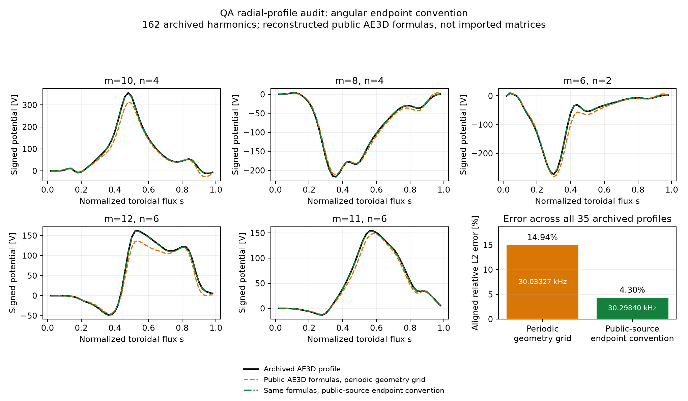

QA vorticity operator audit
===========================

The failed archived-mode comparison is not sufficient evidence that a physical
term is missing from FAX. This audit derives the relevant terms independently,
checks FAX in Cartesian coordinates, and then isolates coefficient differences
in the public AE3D v31 implementation. The production FAX equations were not
changed to reproduce the reference.

Independent differential operator
---------------------------------

For the ideal, incompressible vorticity equation in Knyazev et al., equations
3--4, the stiffness is

.. math::

   K_{ij}=\int dV\,\nabla(\nabla_\parallel f_i)^*\cdot
                         \nabla(\nabla_\parallel f_j).

Define

.. math::

   q=\frac{B}{G+\iota I},\quad \chi_i=m_i\theta-n_i\zeta,\quad
   \kappa_i=n_i-m_i\iota,\quad f_i=N_i(s)\cos\chi_i.

Then the product rule gives

.. math::

   \nabla_\parallel f_i=q\kappa_i N_i\sin\chi_i,

   \partial_s(\nabla_\parallel f_i)=
   [q\kappa_i N_i'+(\kappa_i q_s-m_i\iota' q)N_i]\sin\chi_i,

   \partial_\theta(\nabla_\parallel f_i)=
   \kappa_i N_i[q_\theta\sin\chi_i+m_iq\cos\chi_i].

These identities determine the mode indices in the bending matrix. They do
not depend on the archived eigenfrequency or mode profile.

``tests/test_vorticity_cartesian.py`` checks the assembled functional by
nested Cartesian finite differences of ``b dot grad Phi``, using the inverse
of an analytic toroidal embedding. The manufactured directional field has
magnetic shear and the trial potential contains coupled poloidal harmonics.
The reference calculation does not use the expanded Boozer gradient formulas.
The stiffness agrees within 2e-5 relative and inertia within 2e-6. This is a
differential-operator test, not a claim that the manufactured field is an MHD
equilibrium or an experimental wave benchmark.

Two magnetic-shear index differences
------------------------------------

Write the radial weak form schematically as

.. math::

   A_{ij}N_a'N_b'+B_{ij}N_aN_b'+B_{ji}^*N_a'N_b+D_{ij}N_aN_b.

The public AE3D ``element`` routine multiplies ``bb(i,j)`` by the integral of
``N_a N_b'``. Its ``scs_convolve`` definition fixes which harmonic supplies
the sine and which supplies the cosine. Thus the following differences can
be compared without changing basis or coordinate conventions.

First, the radial magnetic-shear contribution to B must be

.. math::

   B^{\iota'}_{ij}=-m_i\iota'\kappa_j
       \langle Jg^{ss}q^2\sin\chi_i\sin\chi_j\rangle.

The public source uses ``-m_j*iota_prime*kappa_i`` instead. See
``stell_rfp_specific_term2`` and its addition to ``bb2`` in
`AE3D v31 <https://github.com/ORNL-Fusion/AE3D/blob/master/ae_solve_version31.f#L912>`_.

Second, the shear part of the mixed s-theta metric contribution to D must be

.. math::

   D^{s\theta,\iota'}_{ij}=-m_im_j\iota'
   \langle Jg^{s\theta}q^2[
      \kappa_j\sin\chi_i\cos\chi_j+
      \kappa_i\cos\chi_i\sin\chi_j]\rangle.

The public source instead pairs kappa_j with cos(chi_i) sin(chi_j), and
kappa_i with sin(chi_i) cos(chi_j). This is the term
``-ans_css*gst_j*m_i*m_j*kappa_j*iota_prime`` plus its transpose in
`dd2 <https://github.com/ORNL-Fusion/AE3D/blob/master/ae_solve_version31.f#L960>`_.
The convolution ordering is documented in
`fourier_lib_module.f <https://github.com/ORNL-Fusion/AE3D/blob/master/fourier_lib_module.f#L160>`_.

The public expressions therefore do not expand the stated product-rule
operator consistently. This finding concerns the inspected public v31 source;
the exact modified AE3D source revision used for the archived paper run has
not been supplied.

A two-line correction for these specific stellarator-branch terms is provided
as :download:`ae3d_v31_magnetic_shear_indices.patch <_static/ae3d_v31_magnetic_shear_indices.patch>`.
It changes the mixed-shear factor from m_j*kappa_i to m_i*kappa_j, and changes
the shear/poloidal convolution from cos_i*sin_j to sin_i*cos_j. The patch is
checked against the inspected source. No AE3D executable has been rebuilt or
run, and the patch does not address other smaller coefficient or radial
discretization differences.

Controlled calculations
-----------------------

All source-formula controls use the same QA equilibrium, flat mass density,
158 cosine harmonics, 49 interior radial nodes, 80 x 80 angular grid, inertia
matrix and radial coefficient-averaging assembly. Only the specified bending
coefficients change. No imported matrices, particle tracing or fitted density,
frequency or harmonic amplitudes are used.

.. list-table:: Isolation of the bending coefficient differences
   :header-rows: 1

   * - Coefficients
     - Frequency [kHz]
     - Aligned profile error
   * - Product-rule coefficients
     - 27.51462
     - 61.74%
   * - Only mixed radial block from AE3D
     - 27.92079
     - 54.64%
   * - Only zero-radial-derivative block from AE3D
     - 29.24149
     - 49.47%
   * - Only the two shear index interchanges above
     - 30.05844
     - 13.07%
   * - All public AE3D bending coefficients
     - 30.05805
     - 13.02%

The two index interchanges reproduce the full source-formula control to
0.39 Hz. Thus they explain essentially all of the earlier improvement from
replacing the bending expressions as a group. The remaining 13% profile
error and 0.83% frequency difference from the archived 30.30861 kHz mode
are not claimed to be resolved.

The same substitutions were also tested directly in the unchanged native
FAX element kernel, adding only their two derived coefficient differences.
The frequency changes from 27.59467 to 30.11947 kHz and profile error from
62.97% to 14.70%. The mass matrix is bitwise identical and the prefactor
values and derivatives are unchanged. This reproduces the improvement
without replacing the FAX matrix construction. The small difference from
the source-formula control reflects the retained native radial quadrature
and boundary treatment.

The initially suspected sign of derivatives of q is not the main cause.
Using the unchanged native FAX finite-element kernel, reversing only q's
derivatives changes the selected frequency from 27.59467 to 27.59662 kHz
(0.0071%) and profile error from 62.97% to 63.03%. Primitive values,
explicit magnetic shear and the inertia matrix remain unchanged. Correcting
only those derivative signs in the public-source control changes 30.05805
to 30.06368 kHz, again a small effect.

The conclusion is to retain the derived FAX weak form. Matching an archived
mode by introducing the identified index interchanges would change the
operator being tested. Cross-code validation needs a reference whose
expanded coefficients match the same differential equation.

The measured runs, source fingerprints and independent-test results are
recorded in ``examples/research/references/qa_vorticity_operator_audit_20261020.json``.

Recheck the independent operator without any external data:

.. code-block:: bash

   JAX_PLATFORMS=cpu OMP_NUM_THREADS=1 OPENBLAS_NUM_THREADS=1 \
     timeout 120 python -m pytest -q tests/test_vorticity_cartesian.py

The native archived-mode comparison remains reproducible using
``examples/research/qa_ae3d_vorticity_benchmark.py`` as documented in
:doc:`qa_ae3d_vorticity_benchmark`. It continues to report its failed gates;
the audit does not relabel that comparison as passing.

Radial-profile follow-up, 2026-10-21
----------------------------------------

The archived QA header has now been read with explicit approval, using a
single 64 KiB HTTP range and rejecting a full-file response. It confirms
7938 matrix unknowns, 49 radial samples and 162 harmonics. Relative to the
paper table, the archive adds (m,n)=(0,4), (1,4), (2,4), (3,4), and replaces
(24,20), (25,20), (26,20) with (24,16), (25,16), (26,16). The radial sample
coordinates match the exported 35-harmonic reference exactly. Its eigenvalue
also matches the value in the archived header, to floating-point precision.

The native driver now supports ``--harmonics archive``. This fixes a benchmark
input discrepancy without changing the production bending equation. The
original ``paper`` basis remains available for the historical results above.

With this basis, the native weak-form candidate is 27.57218 kHz with 62.53%
aligned retained-profile error. Adding the two index interchanges only as
a diagnostic gives 30.10576 kHz and 13.72% error. These remain separate from
the archived transport input and the successful ESSOS loss comparison.

The geometry-grid endpoint convention explains a large part of the remaining
public-source reconstruction mismatch. STELLGAP's inspected source samples
the angular endpoints inclusively, using denominators N-1. AE3D's Fourier
helper treats its input as an endpoint-exclusive grid, using denominators N.
Holding the actual 162-harmonic basis, 49 interior nodes, 80 x 80 grid, density,
coefficient formulas and radial assembly fixed gives:

.. list-table:: Reconstructed public-AE3D operator against the archived mode
   :header-rows: 1

   * - Geometry sampling supplied to the Fourier products
     - Frequency [kHz]
     - Aligned profile error
   * - Periodic grid, consistent angular locations
     - 30.03327
     - 14.94%
   * - Inspected public-source endpoint convention
     - 30.29840
     - 4.30%
   * - Archived reference
     - 30.30861
     - Reference

The second calculation reproduces the public-source endpoint inconsistency
for diagnosis; it is not a correction to apply to FAX. The archive does not
supply its original matrix files, actual angular grid counts or exact modified
AE3D revision, so the remaining 4.3% is unresolved and this is not a completed
original-matrix benchmark. No frequency, density or per-harmonic amplitudes
were fitted to obtain these results.

The saved numeric profiles and metadata are in
``examples/research/references/qa_vorticity_radial_audit_20261021.npz`` and
the corresponding JSON file. Regenerate this figure without JAX, a solve,
downloads or tracing:

.. code-block:: bash

   python examples/research/plot_qa_ae3d_radial_audit.py

Independent checks of the native FAX calculation
~~~~~~~~~~~~~~~~~~~~~~~~~~~~~~~~~~~~~~~~~~~~~~~~~~~~~~~~

An additional check uses the actual QA embedding and the 35 archived trial
profiles on four off-axis elements and 96 angular/radial points. The reference
evaluates gradients by nested Cartesian central differences and inverts the
physical embedding with Newton iteration. It does not use the expanded
Boozer gradient formula. Reducing the Cartesian step from 2e-4 to 5e-5 m
reduces the bending-energy disagreement from 1.53e-5 to 8.73e-7 relative;
the inertia disagreement reaches 1.13e-7. This supports the stated Eq. 4
operator on this geometry, at these samples. It is not an eigenmode
convergence or full-equilibrium validation.

Other controls rule out several suggested explanations:

* Matching the toroidal resolution per field period changes the native
  frequency by less than 3e-12 relative and does not change the profiles.
  Angular sampling density and endpoint placement are distinct controls.
* Splitting integration at the background half-mesh breaks, while keeping
  the same 51 potential nodes, changes the index-interchanged profile by
  0.47% and its archived-profile error from 13.72% to 13.61%.
* The reconstructed inertia matrix has relative asymmetry below 2e-16;
  the public source's ineffective inertia symmetrization is immaterial here.

The native QA eigenfunction is not yet radially converged. With the actual
162-harmonic basis, increasing the native potential mesh from 51 to 101
nodes shifts the best-overlap candidate from 27.57218 to 27.52558 kHz
(0.169%), while changing its retained profile by 22.09% after a single
global amplitude/sign alignment. Thus the operator checks support retaining
the derived FAX equations, but do not justify declaring this native QA mode
a validated or converged reproduction of the archived mode.

Cosine versus complex exponential basis
----------------------------------------

The two disputed shear coefficients above were compared in the same cosine
basis, with the public convolution definitions and radial derivative placement
held fixed. A change to complex exponentials does not explain their index
interchanges. For each retained harmonic,

.. math::

   \cos\chi_i=\tfrac12(e^{i\chi_i}+e^{-i\chi_i}),\qquad
   P=\tfrac12\begin{bmatrix}I\\I\end{bmatrix},\qquad
   K_{\cos}=P^\dagger K_{\exp}P,\quad
   M_{\cos}=P^\dagger M_{\exp}P.

Both positive and negative harmonic labels are required. For a radial finite
element basis, the same angular projection is applied at each radial node.
Using only the positive exponential harmonics, or solving an unconstrained
complex problem including independent sine components, changes the trial
space; its spectrum need not equal the cosine-restricted spectrum.

Three small CPU tests passed in 8.23 seconds. The existing matrix test checks
the full native stiffness and inertia against the projected complex matrices
on a coupled, sheared, nonorthogonal synthetic 3-D geometry. Two additional
tests use nested automatic directional derivatives to construct the mixed
radial and radial-poloidal shear coefficients in both bases, without using
the expanded magnetic-shear formulas as the derivative reference.

The two coefficient projections agree to 3.61e-15 and 4.87e-16 relative,
respectively, and their independently differentiated values agree with the
derived index placement to 5.32e-15 and 4.38e-15. The interchanged expressions
instead differ by 19.43% and 200% on these manufactured test weights. Those
last two values describe coefficient errors in the algebra test, not QA
eigenfrequency or eigenprofile errors.

This rules out the proposed basis explanation for the identified coefficient
differences under the fixed conventions. It does not settle the remaining
native QA eigenmode convergence or identify the paper's exact AE3D revision.
The production operator and saved particle-loss results are unchanged.
Metrics and the test command are saved in
``examples/research/references/qa_vorticity_basis_audit_20261021.json``.

Reproduce without external data or particle tracing:

.. code-block:: bash

   PYTHONPATH=src:. JAX_PLATFORMS=cpu OMP_NUM_THREADS=1 OPENBLAS_NUM_THREADS=1 \
     timeout 60 python -m pytest -q tests/test_vorticity_basis.py \
       tests/test_vorticity.py::test_cosine_sector_equals_explicit_positive_negative_complex_harmonics
