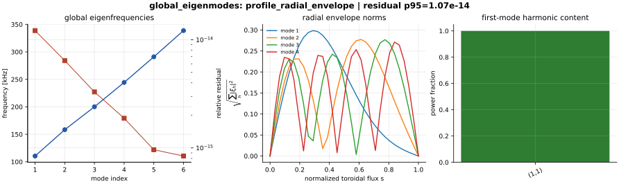

Research Examples
=================

The examples in ``examples/`` are intended to be runnable from a fresh editable
checkout and to produce files that can be inspected by collaborators and
reviewers. They use the current validated reduced-model stack: analytic
continuum limits, metric-matrix checks, VMEC ``wout`` adapter tests, and
differentiability demonstrations.

Install the development extras first:

.. code-block:: bash

   python -m pip install -e ".[dev]"

Configuration Examples
----------------------

``examples/analytic_circular_tokamak.toml``
   Analytic continuum and metric case. Use it for first continuum,
   plotting, and local performance checks.

``examples/analytic_convergence.toml``
   Small analytic case sized for radial/angular/Fourier convergence sweeps.

``examples/landreman_paul_qa_lowres.toml``
   VMEC-backed Landreman-Paul QA low-resolution target. This requires the
   neighboring ``vmec_jax`` checkout data path documented in the README.

``examples/global_eigenmodes.toml``
   Small TOML-driven global radial eigenmode case. Use it to test
   ``fax eigenmodes`` and ``fax plot-global`` without requiring external
   Boozer or VMEC artifacts.

``examples/boozmn_global_eigenmodes.toml``
   Real-Boozer TOML-driven global radial block case. It requires the
   neighboring ``booz_xform_jax`` checkout fixture and exercises the same
   ``fax eigenmodes`` artifact path users will run on new ``boozmn`` files.

Validation Packet
-----------------

Run a compact reviewer-facing packet:

.. code-block:: bash

   python examples/research/validation_packet.py

This writes validation, continuum, convergence, and figure artifacts under
``outputs/research_validation_packet``. It exercises the public Python API and
the same artifact plotting path used by the CLI.

The equivalent CLI sequence is:

.. code-block:: bash

   fax validate examples/analytic_circular_tokamak.toml --tag analytic --tag metric
   fax continuum examples/analytic_circular_tokamak.toml
   fax plot-continuum outputs/analytic_circular_tokamak --output-dir outputs/analytic_circular_tokamak/figures
   fax convergence examples/analytic_convergence.toml --radial-points 16 --radial-points 32 --radial-points 48 --angular-points 8 --angular-points 12 --mode-max 1 --mode-max 2
   fax plot-convergence outputs/analytic_convergence/convergence --output-dir outputs/analytic_convergence/figures

Differentiability
-----------------

Run:

.. code-block:: bash

   python examples/research/density_sensitivity.py

This computes JAX gradients of a mean continuum-branch frequency with respect
to density scale, rotational-transform shift, and magnetic-field scale. It is a
small reproducible sensitivity-analysis template.

Inverse Design
--------------

Run:

.. code-block:: bash

   python examples/research/inverse_iota_shift.py

This is a one-parameter inverse-design toy problem. It adjusts a bounded
rotational-transform shift to move a selected analytic continuum diagnostic
toward a target frequency. It is deliberately simple so that users can inspect
the objective, gradients, and iteration history.

Differentiable Design Study
---------------------------

Run:

.. code-block:: bash

   python examples/research/differentiable_design_study.py --output-dir outputs/differentiable_design_study

This is the first integrated design-facing FAX example. It computes autodiff
sensitivities of global radial eigenfrequencies, propagates parameter
covariance into linearized frequency uncertainty bands, runs a small
gradient-based inverse-design loop to move a mode out of a selected risk
window, and projects a reduced fast-ion drive screen onto the eigenfunctions
before and after the design move.

.. figure:: _static/differentiable_design_study.svg
   :alt: Differentiable FAX design study dashboard.

   Differentiable sensitivity, uncertainty quantification, inverse design, and
   fast-ion risk reduction for the current reduced radial model. This is a new
   research-workflow capability, while full 3-D operator parity remains a
   separate validation lane.

Basic BAE/TAE/EAE Gap Map
-------------------------

Run:

.. code-block:: bash

   python examples/research/basic_alfven_gap_map.py

This writes ``outputs/basic_alfven_gap_map/basic_alfven_gap_map.png`` and
``.svg``. It is a fast large-aspect-ratio reproduction of the standard
Alfvén-continuum gap picture: cylindrical branches, toroidicity-induced TAE
coupling, ellipticity-induced EAE coupling, and a finite-beta/acoustic BAE
accumulation-frequency marker. The script also prints the reference ``q``
locations and frequencies as JSON.

Reduced Global/Gaps/Fast Ions
-----------------------------

Run:

.. code-block:: bash

   python examples/research/global_gap_fastion_screen.py

This prints a JSON packet containing a constant-profile radial spectrum gate,
the lowest reduced radial eigenfrequency for an analytic equilibrium, TAE/EAE/
HAE gap estimates, a reduced fast-ion resonance peak, and the gradient of the
radial-mode avoidance objective.

Boozer Harmonic Validation
--------------------------

Run:

.. code-block:: bash

   python examples/research/boozer_harmonic_validation.py

This prints a JSON packet with Boozer ``|B|`` reconstruction/projection error,
harmonic orthogonality error, straight-field-line phase-slope error, and
normalized non-axisymmetric spectral energy for a synthetic spectrum.

Live VMEC/Boozer Convergence
----------------------------

Run:

.. code-block:: bash

   python examples/research/vmec_boozer_convergence.py --output-dir outputs/vmec_boozer_convergence

This runs the local Landreman-Paul QA ``vmec_jax`` input through the in-memory
``booz_xform_jax`` bridge and checks two production-readiness metrics:
Boozer harmonic truncation and local 3-D operator angular quadrature
convergence. It writes a compact figure and prints JSON metrics; it is not a
converged VMEC physics benchmark.

Real ``boozmn`` Local 3-D Continuum
-----------------------------------

Run:

.. code-block:: bash

   python examples/research/boozmn_3d_continuum.py

This reads a real ``boozmn`` file from the neighboring ``booz_xform_jax``
checkout by default, checks the file-level Boozer-Jacobian identity, compares
the embedding-derived Jacobian shape, solves the local 3-D Boozer continuum
matrix, writes SVG/PNG figures, and prints a JSON summary. Use
``--boozmn path/to/boozmn.nc`` for a new Boozer geometry.

Real ``boozmn`` Global 3-D Eigenmodes
-------------------------------------

Run:

.. code-block:: bash

   python examples/research/boozmn_global_3d_eigenmodes.py

This reads a real ``boozmn`` file, builds the local 3-D Boozer surface
matrices, assembles the global radial block eigenproblem with Dirichlet radial
boundaries, writes radial-envelope/harmonic-structure figures, and prints
frequencies plus residuals as JSON. Use ``--boozmn path/to/boozmn.nc`` for a
new geometry.

TOML-Driven Global Eigenmodes
-----------------------------

Run:

.. code-block:: bash

   fax eigenmodes examples/global_eigenmodes.toml
   fax plot-global outputs/global_eigenmodes/eigenmodes --output-dir outputs/global_eigenmodes/figures
   fax eigenmodes examples/boozmn_global_eigenmodes.toml --max-modes 6
   fax plot-global outputs/boozmn_global_eigenmodes/eigenmodes --output-dir outputs/boozmn_global_eigenmodes/figures

The first command writes frequencies, generalized-eigen residuals, and
``(mode, surface, harmonic)`` mode structures. The second command turns those
artifacts into a publication-draft dashboard. The second pair uses a real
``boozmn`` file and the metric-derived 3-D radial block operator.

   TOML-driven global eigenmode artifact dashboard: frequencies, residuals,
   radial envelope norms, and harmonic content from the public
   ``fax eigenmodes``/``fax plot-global`` workflow.

.. figure:: _static/boozmn_global_eigenmode_artifact_dashboard.svg
   :alt: Real-Boozer global eigenmode artifact dashboard generated from the TOML workflow.

   Real-Boozer TOML-driven global eigenmode artifact dashboard generated from
   the same public workflow and checked against the direct radial block solve.

Real ``boozmn`` Differentiable Design Study
-------------------------------------------

Run:

.. code-block:: bash

   python examples/research/boozmn_differentiable_design_study.py --boozmn path/to/boozmn.nc

This applies the sensitivity/UQ/inverse-design workflow to the real-Boozer
global radial operator. The differentiable path includes Boozer local matrices,
metric-derived radial stiffness, generalized eigenfrequencies, radial/harmonic
eigenfunctions, and a reduced fast-ion risk screen.

.. figure:: _static/boozmn_differentiable_design_study.svg
   :alt: Real boozmn differentiable design study dashboard.

   Real ``boozmn`` differentiable design study. The current local fixture shows
   frequency sensitivities, uncertainty bands, an optimized move away from a
   selected risk window, and reduced fast-ion growth before/after the design
   step.

STELLGAP CTOK Cross-Code Comparison
-----------------------------------

Run after cloning/extracting the public ORNL STELLGAP test artifacts under
``/Users/rogerio/local``:

.. code-block:: bash

   python examples/research/stellgap_ctok_comparison.py

This reads the public CTOK ``boozmn_ctok.nc`` and STELLGAP ``alfven_post``
output, recomputes the local 3-D Boozer continuum branches in FAX, writes an
overlay/error figure, and prints JSON metrics. On the current local fixture the
p95 sorted-spectrum error is about 2.55 percent over 97 matched radial
surfaces. The registered validation suite also compares the largest
adjacent-branch local gap center and width on matched surfaces.

External-Code Artifact Dashboard
--------------------------------

Run after extracting the public ORNL STELLGAP and AE3D answer artifacts under
``/Users/rogerio/local``:

.. code-block:: bash

   python examples/research/external_code_artifact_dashboard.py

This writes a dashboard and JSON metrics for public-code convention checks:
STELLGAP ``alfven_spec`` post-processing to ``alfven_post``, AE3D
``omega2.dat`` to ``egn_values.dat`` eigenvalue conventions, AE3D reported
eigenpair residuals, sparse matrix symmetry, and an independent dense
generalized eigensolve of AE3D's public ``A x = lambda B x`` matrix problem.
These checks are intentionally artifact-level; the next physics step is full
global FAX eigenmode parity against AE3D/CAS3D/FAR3D cases.

FAR3D GPU Lincheck Artifact
---------------------------

Run after the archived FAR3D GPU artifacts are present in the repository:

.. code-block:: bash

   python examples/research/far3d_gpu_lincheck_artifact.py

This reads ``external_artifacts/far3d/gpu_diiid_nvhpc/farprt0000``, parses
FAR3D ``lincheck`` growth/frequency rows, applies the FAR3D-reported
``599.81341 kHz`` per code-frequency-unit conversion, and writes a dashboard
plus JSON metrics. The example verifies the external executable/build and
ingestion path. It is not a converged kinetic growth-rate parity benchmark.

FAR3D GPU Convergence Ladder
----------------------------

Run after the archived FAR3D convergence artifacts are present in the
repository:

.. code-block:: bash

   python examples/research/far3d_gpu_convergence_ladder.py

This reads ``external_artifacts/far3d/gpu_diiid_nvhpc_convergence`` and
compares the ``maxstp = 50, 100, 200, 400`` ``lincheck`` rows against the
400-step reference. The current archived ladder shows the 200-step output below
``3e-5`` maximum relative growth-rate error for common mode labels. Treat this
as a convergence screen for one FAR3D DIII-D input, not as kinetic parity.

FAR3D GPU Fast-Ion Beta Scan
----------------------------

Run after the archived FAR3D beta-scan artifacts are present in the repository:

.. code-block:: bash

   python examples/research/far3d_gpu_beta_scan.py

This reads ``external_artifacts/far3d/gpu_diiid_nvhpc_beta_scan`` and compares
``bet0_f = 0.000, 0.010, 0.030, 0.060, 0.090``. The finite-beta branch has
monotonically increasing parsed mean ``lincheck`` growth, while the beta-zero
run is shown as a control because its printed growth spread is large. Treat
this as the first executable FAR3D parameter-scan artifact for closure
development, not as held-out FAX/FAR3D kinetic parity.

Publication Figure Suite
------------------------

Run:

.. code-block:: bash

   python examples/research/publication_figure_suite.py --output-dir outputs/publication_figure_suite

This writes ten publication-style SVG/PNG figures plus a JSON summary. The
cases are intended to cover the figure families normally requested in
Alfvén-eigenmode studies:

* analytic BAE/TAE/EAE gap taxonomy,
* radial/angular/Fourier convergence and eigensolve residuals,
* VMEC ``wout`` profile/metric continuum inspection for the Landreman-Paul QA
  target,
* Boozer harmonic reconstruction and spectral content,
* real ``boozmn`` local 3-D continuum operation,
* global radial eigenfrequencies, eigenfunctions, and residuals,
* fast-ion resonance drive/damping and eigenfunction overlap,
* autodiff sensitivity checks,
* STELLGAP CTOK local-continuum and local-gap parity with a gap-anchored FAX
  global-mode screen, and
* AE3D public sparse-matrix/eigenmode residual parity.

Generate selected figures with repeated ``--case`` flags, for example:

.. code-block:: bash

   python examples/research/publication_figure_suite.py --case 09 --case 10 --format pdf

The STELLGAP and AE3D cases require the public ORNL artifacts under
``/Users/rogerio/local``. The suite labels those cases as skipped in the JSON
summary if the local artifacts are unavailable.

.. figure:: _static/publication_suite/09_stellgap_ctok_gap_anchored_global_screen.svg
   :alt: STELLGAP CTOK continuum and FAX global-mode screen.

   STELLGAP CTOK local-continuum parity overlaid with the current reduced FAX
   global radial eigenmode screen. The left panel is a parity/inspection
   figure; it should not be described as full AE3D/CAS3D global physics parity.

.. figure:: _static/publication_suite/10_ae3d_matrix_eigenmode_parity.svg
   :alt: AE3D public matrix and eigenmode parity dashboard.

   Public AE3D sparse matrices and ``egn_mode_asci.dat`` eigenvectors checked
   through ``A x = lambda B x`` residuals, Rayleigh-quotient errors, dense
   spectrum recovery, and ``B``-weighted mode-shape correlations. This is now a
   real external matrix/eigenmode parity gate and a prerequisite for future
   FAX-vs-AE3D operator-level validation.

Regenerating Documentation Figures
----------------------------------

The README and documentation figures are generated by:

.. code-block:: bash

   python tools/generate_validation_figures.py
   python tools/qa_figures.py

``tools/qa_figures.py`` parses generated SVG files and checks PNG dimensions and
nonblank pixel coverage. This is the local guard against empty or malformed
review figures.
