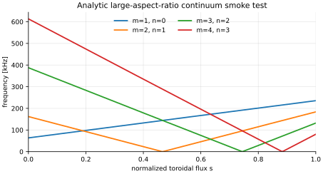
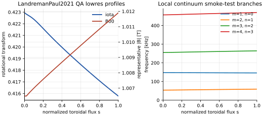
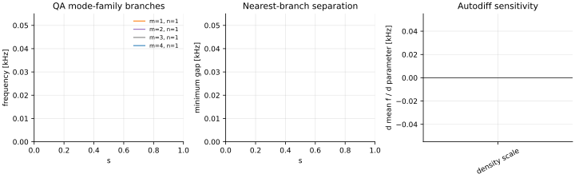
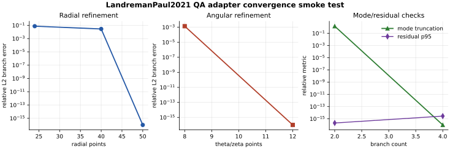

Validation
==========

Validation is a project deliverable, not a final clean-up task. Planned
validation layers include:

* analytic scalings for the shear Alfvén continuum and toroidal gap frequencies,
* axisymmetric tokamak TAE/EAE/NAE benchmarks,
* stellarator continuum comparisons against STELLGAP and recent
  quasisymmetric-continuum results,
* global eigenmode comparisons against AE3D, CAS3D, and EUTERPE cases,
* fast-ion growth-rate comparisons against FAR3D and CAS3D-K limits,
* conservation, symmetry, adjoint, and finite-difference gradient checks,
* regression datasets with tolerances, provenance, and stored plotting scripts.

Each published validation case should include the input files, source citation,
expected metric, tolerance, and the exact command used to regenerate the result.

Current Registered Gates
------------------------

``fax.validation`` now contains a small registry of named validation gates. Each
gate has an identifier, physics layer, measured quantity, tolerance, citation,
tags, and command. The current gates are:

* ``analytic_cylinder_frequency``: verifies the uniform-cylinder continuum
  branch is radially constant.
* ``metric_matches_profile_limit``: checks the angular-grid metric matrix
  reduces to the profile continuum formula in the uniform straight-field-line
  limit.
* ``metric_matrix_hermitian``: checks Hermiticity of the local generalized
  continuum stiffness and mass matrices.
* ``metric_eigensolve_residual``: checks dense generalized Hermitian
  eigenvectors through ``Kx = lambda Mx`` residual norms.
* ``density_scale_gradient``: checks JAX autodiff against the analytic
  ``rho^(-1/2)`` density scaling.
* ``metric_angular_convergence``: checks that the analytic metric fixture is
  insensitive to angular-grid refinement.
* ``metric_radial_convergence``: checks that analytic metric-matrix continuum
  branches converge under radial-grid refinement.
* ``analytic_radial_integral_convergence``: checks radial quadrature convergence
  for a smooth analytic continuum branch.
* ``landreman_paul_adapter_smoke``: checks the Landreman-Paul QA VMEC ``wout``
  profile and metric adapters when local data are available.
* ``landreman_paul_continuum_finite``: checks that the Landreman-Paul profile
  and metric continuum branches are finite and have small eigensolve residuals.
* ``landreman_paul_radial_sampling_convergence``: checks VMEC-backed radial
  sampling refinement for the current adapter.

Run them from Python:

.. code-block:: python

   from fax.validation import registered_validation_gates, run_validation_suite

   for gate in registered_validation_gates():
       print(gate.gate_id, gate.tolerance, gate.citation)

   results = run_validation_suite()

Run the same gates from the CLI, with rich phase-by-phase output and artifacts:

.. code-block:: bash

   fax validate examples/minimal.toml
   fax validate examples/minimal.toml --tag metric --json

The CLI writes ``validation_summary.json`` and ``validation_report.md`` to
``run.output_dir`` unless ``--no-artifacts`` is used.

Resolution sweeps are available through the convergence workflow:

.. code-block:: bash

   fax convergence examples/landreman_paul_qa_lowres.toml
   fax convergence examples/minimal.toml --radial-points 16 --radial-points 32 --angular-points 8 --angular-points 12 --mode-max 1 --mode-max 2 --json

This writes a CSV table, JSON summary, and Markdown report comparing each
radial/angular/Fourier truncation against the highest-resolution entry in the
sweep. Branch matrices on coarser radial grids are interpolated onto the
reference radial grid before relative L2 errors are computed.

These are scaffold acceptance gates. Publication claims about 3-D stellarator
continuum gaps still require the planned STELLGAP/AE3D/literature comparison
gates and resolution-convergence reports.

First Local Stellarator Target
------------------------------

The first VMEC-backed stellarator target is
``LandremanPaul2021_QA_lowres``. It is a low-resolution version of the precise
quasi-axisymmetric Landreman-Paul configuration and is already available in the
neighboring ``vmec_jax`` checkout as a VMEC input and ``wout`` file. The bundled
``examples/landreman_paul_qa_lowres.toml`` file points to those local paths.

This case should be used first for adapter smoke tests, continuum-map
development, Boozer-pipeline checks, and early performance measurements. It is
not a validation by itself until the relevant continuum/eigenmode metrics are
compared with analytic limits or literature/cross-code references.

Current Smoke-Test Figures
--------------------------

The current figures are generated by ``tools/generate_validation_figures.py``.
They are smoke tests for the first analytic formulas and local VMEC adapter, not
yet full 3-D Alfvén-continuum validation.

   Analytic large-aspect-ratio continuum branches used to test scaling,
   harmonic labeling, and density/iota differentiability.

   First VMEC-backed stellarator reference target. The right panel uses the
   local large-aspect-ratio smoke-test formula, so it is a development check
   rather than a validated stellarator continuum calculation.

   Prototype dashboard combining a mode-family branch map, nearest-branch
   separation, and autodiff sensitivities. This is a figure-design and
   differentiability smoke test.

   VMEC-backed adapter convergence smoke test generated by ``fax convergence``.
   It checks artifact/report plumbing and current radial/angular/Fourier
   refinement behavior; full stellarator continuum validation still requires
   cross-code or literature comparison.
