Validation
==========

Validation is a project deliverable, not a final clean-up task. Planned
validation layers include:

* analytic scalings for the shear Alfvén continuum and toroidal gap frequencies,
* axisymmetric tokamak TAE/EAE/NAE benchmarks,
* stellarator continuum comparisons against STELLGAP and recent
  quasisymmetric-continuum results,
* global eigenmode comparisons against AE3D, CAS3D, and EUTERPE cases,
* fast-ion growth-rate comparisons against FAR3D and CAS3D-K limits,
* conservation, symmetry, adjoint, and finite-difference gradient checks,
* regression datasets with tolerances, provenance, and stored plotting scripts.

Each published validation case should include the input files, source citation,
expected metric, tolerance, and the exact command used to regenerate the result.

Current Registered Gates
------------------------

``fax.validation`` now contains a small registry of named validation gates. Each
gate has an identifier, physics layer, measured quantity, tolerance, citation,
tags, and command. The current gates are:

* ``analytic_cylinder_frequency``: verifies the uniform-cylinder continuum
  branch is radially constant.
* ``metric_matches_profile_limit``: checks the angular-grid metric matrix
  reduces to the profile continuum formula in the uniform straight-field-line
  limit.
* ``metric_matrix_hermitian``: checks Hermiticity of the local generalized
  continuum stiffness and mass matrices.
* ``metric_eigensolve_residual``: checks dense generalized Hermitian
  eigenvectors through ``Kx = lambda Mx`` residual norms.
* ``density_scale_gradient``: checks JAX autodiff against the analytic
  ``rho^(-1/2)`` density scaling.
* ``metric_angular_convergence``: checks that the analytic metric fixture is
  insensitive to angular-grid refinement.
* ``metric_radial_convergence``: checks that analytic metric-matrix continuum
  branches converge under radial-grid refinement.
* ``analytic_radial_integral_convergence``: checks radial quadrature convergence
  for a smooth analytic continuum branch.
* ``global_mode_constant_profile``: checks the reduced radial eigenmode
  finite-difference spectrum against the exact constant-profile spectrum and
  eigenpair residuals.
* ``global_mode_density_gradient``: checks JAX autodiff through the radial
  generalized eigenproblem against the analytic ``rho^(-1/2)`` scaling.
* ``global_3d_block_constant_spectrum``: checks the block radial 3-D
  eigenproblem against an exact diagonal constant-coefficient spectrum.
* ``global_3d_block_neumann_spectrum``: checks the same block problem with
  zero-gradient Neumann radial boundaries against the exact spectrum.
* ``global_3d_block_density_gradient``: checks JAX autodiff through the block
  radial generalized eigenproblem against the analytic ``rho^(-1/2)`` scaling.
* ``global_3d_block_eigenvalue_sensitivity``: checks the isolated Hermitian
  generalized-eigenvalue adjoint formula
  ``x^H(dK-lambda dM)x/(x^H M x)`` against direct JAX autodiff for mass and
  radial-stiffness tangent directions.
* ``global_3d_block_custom_jvp_eigenvalue``: checks that the custom-JVP
  isolated-eigenvalue path returns the same radial-block gradient as the
  explicit adjoint formula.
* ``boozer_global_custom_jvp_design_gradient``: checks the custom-JVP
  isolated-mode gradient for real-Boozer global design variables against
  centered finite differences.
* ``global_3d_block_degenerate_cluster_mean``: checks that a degenerate
  two-harmonic radial block cluster has a finite-difference-consistent
  cluster-mean gradient.
* ``boozer_global_cluster_mean_design_gradient``: checks that a real-Boozer
  global cluster-mean objective has finite-difference-consistent design
  gradients.
* ``analytic_tae_gap_center``: checks the analytic TAE crossing condition
  ``iota=2n/(2m+1)``.
* ``basic_gap_map_ordering``: checks that the fast BAE/TAE/EAE example places
  TAE and EAE at their large-aspect-ratio reference ``q`` surfaces and orders
  the BAE, TAE, and EAE frequencies correctly.
* ``bae_temperature_scaling``: checks that the BAE accumulation marker follows
  the expected ``sqrt(T_i)`` scaling at fixed ``T_e/T_i``.
* ``fast_ion_resonance_peak``: checks that the reduced fast-ion drive peaks at
  the transit/precession resonance.
* ``fast_ion_eigenfunction_drive_localization``: checks that mode-resolved
  fast-ion drive follows eigenfunction overlap with a resonant pressure
  gradient profile.
* ``fast_ion_gyro_landau_closure_signs``: checks that the reduced
  gyro-Landau closure peaks at resonance, preserves the pressure-gradient
  drive sign, and applies the documented damping offset.
* ``fast_ion_gyro_landau_calibration``: checks that the differentiable
  least-squares calibration layer recovers synthetic resonant, dispersive, and
  thermal-Landau coefficients from eigenfunction-weighted growth rates.
* ``fax kinetic-parity`` and ``fax.kinetic_validation`` define the real
  FAR3D/CAS3D-K growth-rate packet contract: cases must carry uncertainties,
  calibration/validation splits, and held-out parity metrics before calibrated
  kinetic claims are allowed.
* ``boozer_harmonic_projection``: checks Boozer ``|B|`` harmonic
  reconstruction/projection and Fourier orthogonality on a synthetic spectrum.
* ``boozer_straight_field_line_phase``: checks that Boozer harmonic phases have
  slope ``m*iota-n`` along a straight field line.
* ``boozer_constant_field_continuum``: checks that the reduced Boozer continuum
  matrix recovers ``omega=v_A |n-m*iota|/R`` for constant ``|B|``.
* ``boozer_sideband_coupling_hermitian``: checks that a known Boozer harmonic
  produces nonzero sideband coupling while keeping the matrix Hermitian.
* ``boozer_jacobian_identity``: checks the Boozer-coordinate identity
  ``J_B |B|^2 = G + iota I`` for a synthetic harmonic spectrum.
* ``boozer_metric_constant_field_continuum``: checks that the
  Boozer-Jacobian weighted matrix recovers the constant-field profile limit.
* ``boozer_metric_mass_coupling``: checks that nonuniform ``J_B`` produces
  mass-matrix coupling while ``J_B |B|^2`` cancels sideband stiffness coupling
  in the reduced bridge.
* ``boozer_3d_constant_field_continuum``: checks that the local 3-D Boozer
  operator recovers ``omega=v_A |n-m*iota|/R`` in the constant-field limit.
* ``boozmn_geometry_jacobian_identity``: reads a real ``boozmn`` fixture and
  checks ``sqrt(g)|B|^2 = G + iota I`` from file harmonics.
* ``booz_xform_jax_live_geometry_adapter``: runs the live
  ``booz_xform_jax`` VMEC-to-Boozer JAX adapter on an asymmetric fixture and
  compares all field, embedding, shift, and Jacobian harmonics against the
  BOOZ_XFORM ``boozmn`` reference.
* ``booz_xform_jax_in_memory_geometry_adapter``: exercises the no-file
  ``vmec_jax`` handoff path by passing an in-memory VMEC ``wout``-like object
  through ``booz_xform_jax`` and comparing the resulting FAX geometry against
  the same asymmetric ``boozmn`` reference.
* ``boozmn_embedding_jacobian_shape``: compares the physical embedding
  Jacobian shape reconstructed from ``R``, ``Z``, and ``p`` against the
  ``boozmn`` Jacobian harmonics up to one surface-wise radial-coordinate scale.
* ``boozmn_3d_continuum_finite``: checks that a real ``boozmn`` local 3-D
  continuum matrix is Hermitian and produces finite non-negative branches.
* ``boozmn_global_3d_eigenmode_finite``: assembles real ``boozmn`` local 3-D
  Boozer matrices into a global radial block eigenproblem and checks finite
  frequencies, mode structures, and residuals.
* ``boozmn_metric_radial_stiffness_hermitian``: checks the real-geometry
  Boozer radial derivative energy matrix for Hermiticity and positivity.
* ``boozmn_global_angular_convergence``: checks real-``boozmn`` global radial
  block eigenfrequencies against a refined Boozer angular quadrature grid.
* ``boozmn_global_radial_surface_coarsening``: checks lowest real-``boozmn``
  global radial block modes under a documented surface-coarsening perturbation.
* ``boozmn_global_boundary_and_stiffness_variants``: checks finite,
  low-residual global radial block solves for Dirichlet/Neumann boundaries and
  metric/mass radial-stiffness variants.
* ``stellgap_ctok_local_continuum``: compares FAX local 3-D Boozer continuum
  branches against the public ORNL STELLGAP CTOK test problem.
* ``stellgap_ctok_largest_gap_parity``: compares the largest local
  adjacent-branch gap center and width on matched CTOK surfaces between FAX
  and public STELLGAP outputs.
* ``stellgap_public_postprocess_parity``: reproduces the STELLGAP
  ``post_process.f`` convention that converts public ``alfven_spec`` rows into
  the published ``alfven_post`` frequency table.
* ``ae3d_public_eigenvalue_artifact``: checks that the public ORNL AE3D
  eigenvalue answer table is readable and has small reported residuals. This
  is an external-artifact smoke gate, not yet a FAX-vs-AE3D eigenmode
  comparison.
* ``ae3d_public_omega2_eigenvalue_parity``: checks AE3D's convention that
  positive ``omega2.dat`` eigenvalues are square-rooted in ``egn_values.dat``
  while negative entries are preserved.
* ``ae3d_public_matrix_symmetry``: checks the symmetry of public AE3D
  ``a_matrix.dat`` and ``b_matrix.dat`` generalized-eigenproblem artifacts.
* ``ae3d_public_matrix_eigenmode_parity``: checks public AE3D
  ``egn_mode_asci.dat`` eigenvectors against public ``a_matrix.dat`` and
  ``b_matrix.dat`` through ``A x = lambda B x`` residuals and Rayleigh
  quotient errors for the first modes.
* ``ae3d_public_dense_spectrum_parity``: independently solves the public AE3D
  dense generalized eigenproblem with SciPy/LAPACK and matches the first
  published ``omega^2`` eigenvalues from ``egn_mode_asci.dat``.
* ``ae3d_public_global_mode_shape_parity``: independently solves the public
  AE3D global matrix problem and compares both frequencies and eigenvectors
  against ``egn_mode_asci.dat`` using Euclidean and ``B``-weighted
  correlations. This is public matrix parity, not yet native FAX-operator
  parity.
* ``ae3d_public_continuum_placement_parity``: uses public AE3D global
  eigenmodes, their dominant-harmonic radial peak locations, and the CTOK
  Boozer geometry to check that each AE3D global eigenfrequency lies near the
  closest FAX local Boozer continuum branch. This is a global-mode placement
  physics gate, still short of full native FAX-vs-AE3D operator parity.
* ``landreman_paul_adapter_smoke``: checks the Landreman-Paul QA VMEC ``wout``
  profile and metric adapters when local data are available.
* ``landreman_paul_vmec_jax_boozer_in_memory``: runs a one-iteration
  ``vmec_jax`` fixed-boundary solve on the Landreman-Paul QA input, passes the
  live ``wout`` object through ``booz_xform_jax`` without writing an
  intermediate file, and checks the resulting FAX Boozer geometry for a small
  Jacobian-identity error and finite local 3-D continuum branches. This is an
  integration smoke gate, not a converged VMEC physics benchmark.
* ``landreman_paul_vmec_jax_boozer_truncation_convergence``: reuses one live
  ``vmec_jax`` ``wout`` object, compares ``(mboz,nboz)=(4,4)`` against
  ``(5,5)``, and gates sampled ``|B|`` error, local 3-D continuum frequency
  error, and Boozer-Jacobian identity error.
* ``landreman_paul_vmec_jax_boozer_operator_angular_convergence``: holds the
  live Landreman-Paul Boozer geometry fixed and compares local 3-D operator
  frequencies from ``12x12``, ``16x16``, and ``20x20`` angular quadrature
  against a ``32x32`` reference grid while also checking matrix Hermiticity.
* ``landreman_paul_vmec_jax_solve_convergence``: runs a native-grid
  ``vmec_jax`` iteration ladder on the Landreman-Paul QA input, transforms
  each iterate through ``booz_xform_jax``, and compares Boozer ``|B|`` plus FAX
  local continuum frequencies against the converged reference ``wout``.
* ``landreman_paul_vmec_boundary_alfven_gradient``: differentiates an actual
  VMEC boundary Fourier coefficient through the in-memory
  ``vmec_jax -> booz_xform_jax -> FAX`` chain, checks the smooth global-mode
  risk-objective gradient against centered finite differences, and verifies
  that one line-searched shape step lowers the risk metric.
* ``landreman_paul_vmec_boundary_gradient_convergence``: repeats that
  end-to-end gradient check over a VMEC-iteration ladder and gates gradient,
  objective, and global-frequency drift against the refined entry.
* ``landreman_paul_continuum_finite``: checks that the Landreman-Paul profile
  and metric continuum branches are finite and have small eigensolve residuals.
* ``landreman_paul_radial_sampling_convergence``: checks VMEC-backed radial
  sampling refinement for the current adapter.

Run them from Python:

.. code-block:: python

   from fax.validation import registered_validation_gates, run_validation_suite

   for gate in registered_validation_gates():
       print(gate.gate_id, gate.tolerance, gate.citation)

   results = run_validation_suite()

Run the same gates from the CLI, with rich phase-by-phase output, per-gate
start/done lines, elapsed timings, and artifacts:

.. code-block:: bash

   fax validate examples/minimal.toml
   fax validate examples/minimal.toml --tag metric --json

The CLI writes ``validation_summary.json`` and ``validation_report.md`` to
``run.output_dir`` unless ``--no-artifacts`` is used.

Resolution sweeps are available through the convergence workflow:

.. code-block:: bash

   fax convergence examples/landreman_paul_qa_lowres.toml
   fax convergence examples/minimal.toml --radial-points 16 --radial-points 32 --angular-points 8 --angular-points 12 --mode-max 1 --mode-max 2 --json
   fax plot-convergence outputs/convergence --output-dir outputs/figures

This writes a CSV table, JSON summary, and Markdown report comparing each
radial/angular/Fourier truncation against the highest-resolution entry in the
sweep. Branch matrices on coarser radial grids are interpolated onto the
reference radial grid before relative L2 errors are computed.

These are reduced-model and artifact-parity acceptance gates. Publication claims about 3-D stellarator
continuum gaps now start from the STELLGAP CTOK local-continuum and local-gap
gates, but still require more geometries, global AE3D/CAS3D/FAR3D
comparisons, executable runtime packets, and resolution-convergence reports.

First Local Stellarator Target
------------------------------

The first VMEC-backed stellarator target is
``LandremanPaul2021_QA_lowres``. It is a low-resolution version of the precise
quasi-axisymmetric Landreman-Paul configuration and is already available in the
neighboring ``vmec_jax`` checkout as a VMEC input and ``wout`` file. The bundled
``examples/landreman_paul_qa_lowres.toml`` file points to those local paths.

This case should be used first for adapter checks, continuum-map
development, Boozer-pipeline checks, and early performance measurements. It is
not a validation by itself until the relevant continuum/eigenmode metrics are
compared with analytic limits or literature/cross-code references.

The first live-equilibrium path is the
``landreman_paul_vmec_jax_boozer_in_memory`` gate. It intentionally uses one
low-resolution ``vmec_jax`` iteration so it can run in local development and
exercise the end-to-end object handoff. Converged ``vmec_jax`` solves, Boozer
truncation sweeps, and external-code continuum comparisons remain required
before this path can support publication-level stellarator claims.
The companion ``landreman_paul_vmec_jax_boozer_truncation_convergence`` gate
starts that convergence ladder by holding the same VMEC state fixed and
checking that the FAX Boozer geometry and local continuum are stable between
nearby Boozer harmonic truncations.
The ``landreman_paul_vmec_jax_boozer_operator_angular_convergence`` gate then
holds the Boozer geometry fixed and checks angular quadrature convergence of
the local 3-D operator itself.
The ``landreman_paul_vmec_boundary_alfven_gradient`` gate is the first
design-variable differentiability gate on this same reference family. It uses
the differentiable fixed-boundary VMEC path and must be followed by
VMEC-iteration, Boozer-truncation, surface-count, and finite-difference
convergence ladders before using a boundary-gradient result as a final
reactor-design recommendation. The
``landreman_paul_vmec_boundary_gradient_convergence`` gate now implements the
first such ladder for VMEC iteration count; Boozer truncation, surface count,
angular quadrature, and multi-parameter gradient ladders remain the next
closure items.

Current Validation Figures
--------------------------

The current figures are generated by ``tools/generate_validation_figures.py``.
They combine analytic reference checks, reduced-operator diagnostics,
adapter/convergence checks, and cross-code artifact comparisons. Each caption
states the level of claim it supports.

.. figure:: _static/analytic_continuum_scaling.svg
   :alt: Analytic large-aspect-ratio continuum branches.

   Analytic large-aspect-ratio continuum branches used to test scaling,
   harmonic labeling, and density/iota differentiability.

.. figure:: _static/landreman_paul_qa_lowres_profiles.svg
   :alt: LandremanPaul2021 QA lowres profiles and local continuum branches.

   First VMEC-backed stellarator reference target. The right panel uses the
   local large-aspect-ratio profile formula, so it is a development check
   rather than a validated stellarator continuum calculation.

.. figure:: _static/gap_sensitivity_dashboard.svg
   :alt: Gap and sensitivity dashboard for the LandremanPaul2021 QA lowres case.

   Prototype dashboard combining a mode-family branch map, nearest-branch
   separation, and autodiff sensitivities. This is a figure-design and
   differentiability check.

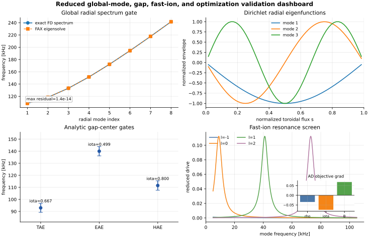

   Reduced global radial spectrum, radial eigenfunctions, analytic gap-center
   estimates, fast-ion resonance screen, and optimization-gradient check.
   This exercises the new end-to-end differentiable reduced path without
   claiming full 3-D stellarator eigenmode validation.

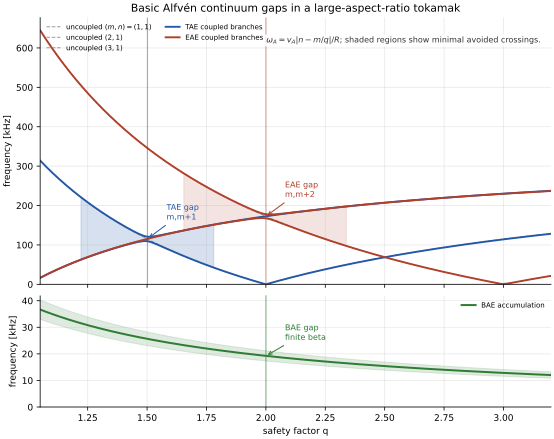

   Fast user-facing large-aspect-ratio reproduction of standard continuum gaps:
   TAE from toroidal ``m,m+1`` coupling, EAE from elliptic ``m,m+2`` coupling,
   and the low-frequency BAE accumulation marker. This is a pedagogical
   analytic reference, not a 3-D stellarator benchmark.

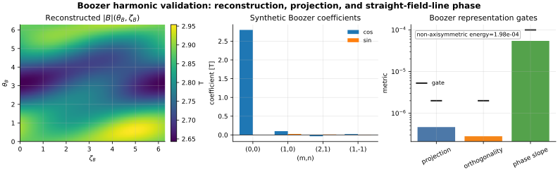

   Boozer harmonic reconstruction/projection, Fourier orthogonality, and
   straight-field-line phase checks. These validate representation conventions
   before Boozer metric operators are used for continuum claims. The plotted
   spectrum is synthetic and is not intended to be quasisymmetric.

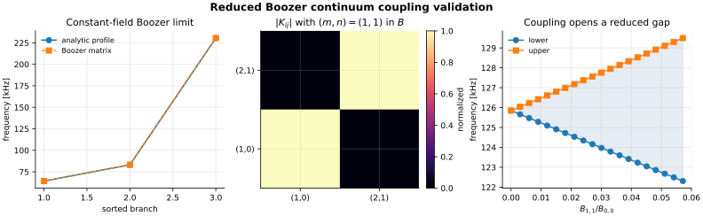

   Reduced Boozer continuum matrix checks: constant-field reduction to the
   analytic profile limit, Hermitian sideband coupling from a known Boozer
   harmonic, and gap opening as the harmonic amplitude increases.

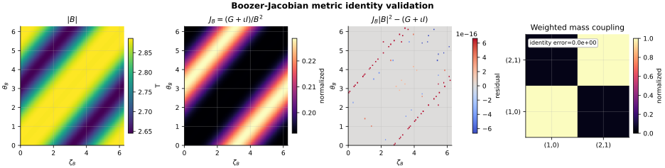

   Boozer-Jacobian metric identity checks: sampled ``|B|``, the corresponding
   ``J_B=(G+iota I)/B^2`` weight, the flux-function product ``J_B |B|^2``,
   and the weighted mass-matrix coupling used by the reduced bridge.

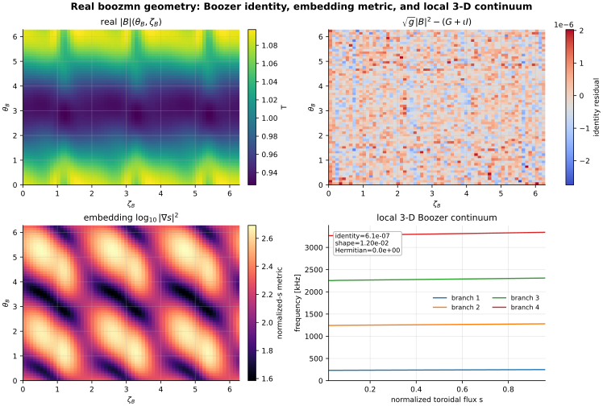

   Real ``boozmn`` geometry gate using the local ``booz_xform_jax`` fixtures:
   sampled ``|B|``, the file-level Boozer-Jacobian identity residual, the
   embedding-derived ``|\\nabla s|^2`` shape, and the first local 3-D Boozer
   continuum branches. This fixture is used to exercise asymmetric Boozer
   harmonics; it is not a Landreman-Paul QA quasisymmetry claim.

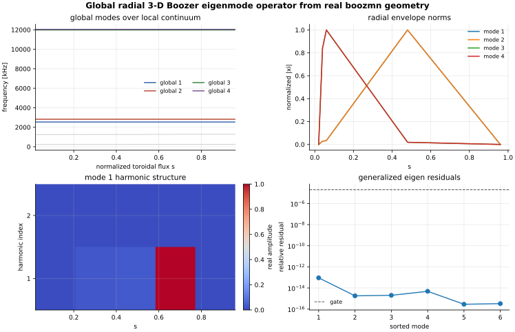

   Global radial 3-D Boozer eigenmode gate from a real ``boozmn`` fixture:
   local continuum branches, global eigenfrequencies, radial envelopes,
   harmonic content of the first mode, and generalized-eigen residuals. This
   validates the radial block operator and mode-structure plumbing before
   cross-code STELLGAP/AE3D benchmarking.

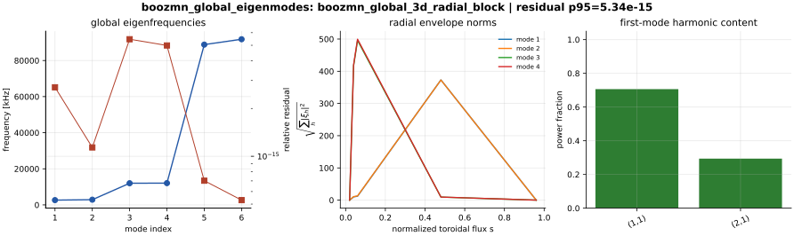

   User-facing real-Boozer workflow gate. The TOML/CLI path writes
   eigenfrequency, residual, and mode-structure artifacts, and the test suite
   compares those artifacts against the direct metric-derived radial block
   solve on the same ``boozmn`` geometry.

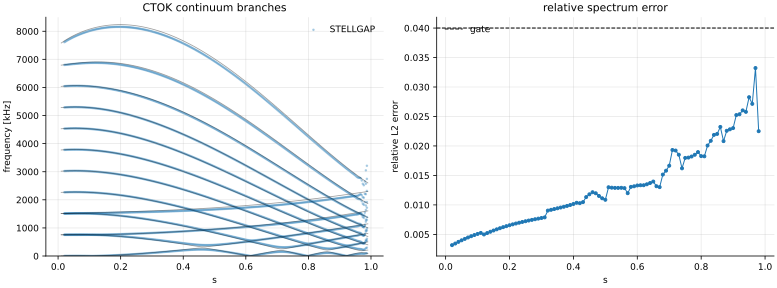

   First public cross-code gate: FAX local 3-D Boozer continuum branches
   compared with ORNL STELLGAP CTOK ``alfven_post`` output. The current p95
   relative spectrum error is below the 4 percent gate over 97 matched
   surfaces.

The AE3D public answer table and sparse generalized-eigenproblem artifacts are
also parsed in local validation so future global-eigenmode parity work starts
from tested artifact readers. FAX now verifies AE3D's public matrix/eigenmode
triplet internally through residuals and Rayleigh quotients, and independently
re-solves the public generalized matrix problem to recover the published
spectrum. FAX also places public AE3D global eigenmode peaks on its CTOK local
Boozer continuum and checks the closest-branch frequency error. This is still
external matrix/eigenmode plus continuum-placement parity, not yet a claim that
the current reduced FAX radial operator reproduces AE3D's full physics
operator.

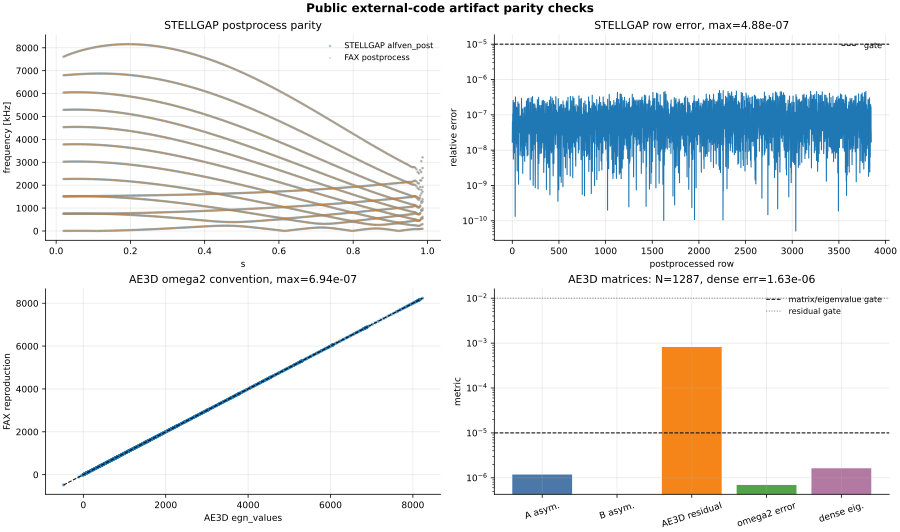

   STELLGAP and AE3D artifact-convention dashboard. These gates prove that FAX
   can read and reproduce public external-code answer conventions before using
   those files for stricter FAX-vs-code physics comparisons.

.. figure:: _static/landreman_paul_convergence_dashboard.svg
   :alt: LandremanPaul2021 QA radial, angular, and Fourier convergence dashboard.

   VMEC-backed adapter convergence check generated by ``fax convergence``.
   It checks artifact/report plumbing and current radial/angular/Fourier
   refinement behavior; full stellarator continuum validation still requires
   cross-code or literature comparison.

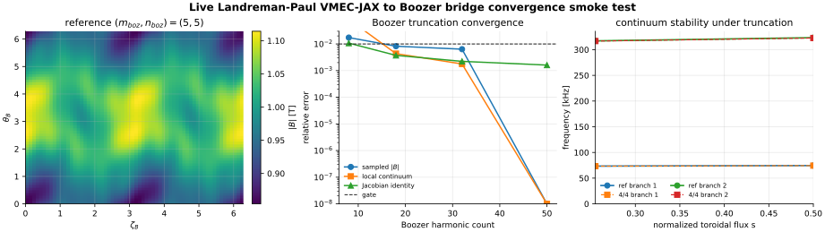

   Live Landreman-Paul ``vmec_jax`` to ``booz_xform_jax`` convergence check.
   The same one-iteration VMEC state is transformed at multiple Boozer
   truncations; the gate checks sampled ``|B|`` reconstruction, local 3-D
   continuum frequencies, and the Boozer-Jacobian identity.

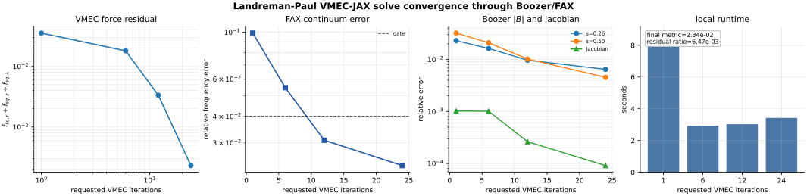

   Landreman-Paul ``vmec_jax`` residual convergence propagated through
   ``booz_xform_jax`` and the FAX local 3-D Boozer continuum operator. The gate
   checks residual reduction and decreasing reference errors before treating
   the live equilibrium as a usable physics input.

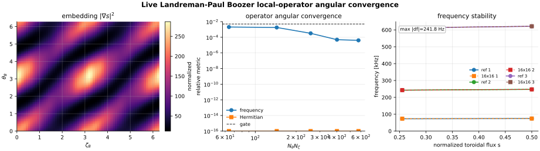

   Live Landreman-Paul Boozer local-operator angular convergence check.
   The Boozer geometry is fixed while angular quadrature is refined, checking
   local continuum frequency stability and matrix Hermiticity.

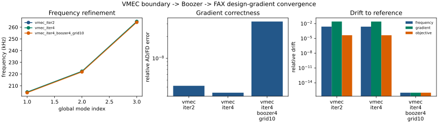

   VMEC-boundary design-gradient convergence ladder. Each level repeats the
   AD/finite-difference gradient check through ``vmec_jax``,
   ``booz_xform_jax``, and the FAX global Alfvén objective, then compares
   frequency, objective, and gradient drift with the reference level.
